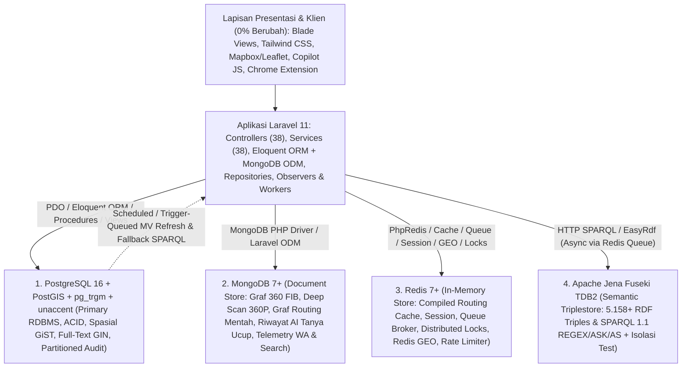

# Blueprint Analisis Web Semantik & Rencana Upgrade Arsitektur Multi-Database MSBD — USUSTARTERMAP (USUClassMap)

- **Target Repositori:** `USUSTARTERMAP` (`D:\Documents\TUBES WEB SEMANTIK\Kelompok 3 Web Semantik`)
- **Subfolder Aplikasi Laravel:** `USUClassMap/`
- **Tanggal Audit & Penyusunan:** 26 November 2026
- **Baseline Sistem:** Aplikasi Web Semantik (`Laravel ^11.31`, `PHP ^8.2`, `SQLite`, `Apache Jena Fuseki`, `Vite ^6.0.11`, `Tailwind CSS ^4.3.3`, `Alpine.js ^3.16.2`, `Mapbox GL ^3.35.2`)
- **Target Upgrade:** Arsitektur **Manajemen Sistem Basis Data (MSBD)** Multi-Database (**PostgreSQL 16 + PostGIS + `pg_trgm`** sebagai primary RDBMS/Spatial/ACID, **MongoDB 7+** sebagai Document & Telemetry Store, **Redis 7+** sebagai In-Memory Cache/Lock/Queue/Session/Geo Store, dan **Apache Jena Fuseki TDB2** sebagai RDF Knowledge Graph & SPARQL 1.1 Triplestore) + **ORM/ODM** + **10 Kategori Komponen Basis Data Lanjutan**.

---

## Ringkasan Eksekutif & Prinsip Mutlak Upgrade

Upgrade dari sistem **Web Semantik (WS)** ke **Manajemen Sistem Basis Data (MSBD)** dilakukan dengan mempertahankan **paritas fungsional 100%** di seluruh sisi pengguna, kasir, admin fotokopi, dan admin akademik. Seluruh antarmuka Blade, komponen interaktif, gaya visual, kontrak respons API JSON, dan aturan bisnis **tidak diubah**; seluruh peningkatan difokuskan pada infrastruktur penyimpanan data, pemodelan relasional-spasial-dokumen, konkurensi & *locking* transaksi, *indexing* lanjutan, dan mekanisme caching/antrean.

### Prinsip Mutlak (*Non-Negotiable Rules*)
1. **0% Perubahan Desain UI/UX & Logika Bisnis:** Seluruh file antarmuka (`resources/views/**`, `resources/css/**`, `resources/js/**`), alur checkout multi-PDF, strategi pembayaran, rumus peringkat Smart Search, bot **Tanya Ucup**, tur virtual 360° FIB, maupun endpoint API JSON harus mempertahankan struktur output dan perilaku yang identik antara WS dan MSBD.
2. **Pemetaan Utuh 100% Tanpa Fitur Hilang:** Seluruh **16 domain fitur**, **1.229 berkas** di `USUClassMap/` (**451 berkas kode murni / 106.488 LOC** + **768 berkas aset/snapshot/dataset/lockfile** + 10 file sementara lokal), modul pendamping (`usu-extension/`, `usu-scraper/`, `jena-6.2.0-source-release/`), serta **19 dokumen audit/spesifikasi** dipetakan tuntas.
3. **Arsitektur Melampaui Syarat Minimum:** Tidak hanya berhenti pada syarat minimal 3 database atau 5–6 komponen basis data, rancangan ini memakai **4 Engine Database** yang saling melengkapi, **ORM + ODM**, dan **10 Kategori Komponen Basis Data Lanjutan** yang setiap objeknya berakar langsung dari hambatan riil pada kode WS aktual.

### Ringkasan Angka Audit Aktual Sistem WS (26 November 2026)

| Dimensi Audit | Fakta Terverifikasi | Keterangan |
|---|---|---|
| Total Berkas Git-Visible (`USUClassMap/`) | **1.229 berkas** | `451` berkas kode murni (`106.488 LOC`), `768` berkas aset/snapshot/dataset/lockfile (`193.575` baris), `10` berkas sementara lokal (`__pycache__`, stackdump, raw image duplikat) |
| Controller & Service Backend | **38 Controller**, **38 Service** | Mencakup Admin Akademik, Spatial Map, Admin/Kasir Fotokopi, Public Fotokopi, Routing, Smart Search, AI Copilot, SPARQL/RDF, Virtual Walk 360°, Payment, Invoice PDF, & WhatsApp |
| Skema Relasional WS | **33 Migrasi**, **27 Tabel SQLite**, **20 Model Eloquent** + `1 Trait` | Terdiri dari `19` tabel domain bisnis, `7` tabel runtime Laravel (`sessions`, `cache`, `cache_locks`, `jobs`, `job_batches`, `failed_jobs`, `password_reset_tokens`), dan `migrations` |
| Dataset Akademik & Spasial | **77 Gedung**, **133 Ruangan**, **266 `room_media`**, **142 Matkul**, **132 Dosen**, **318 Jadwal** | `100%` gedung berkoordinat (`77/77`); `100%` ruangan memiliki foto 360° & foto pintu (`133` 360° + `133` foto pintu); **5.158 RDF triples** aktif di Fuseki |
| Dataset Mitra Fotokopi & Transaksi | **33 Mitra** (`fotocopy_stores` ↔ `photocopy_places`), **3.493 Katalog** (`fotocopy_services` ↔ `photocopy_items`), **65 Order** | `2.524` barang ATK + `969` jasa cetak/fotokopi/jilid + `112` master services (`332` pivot); `55` order lunas (`Rp 2.031.300`) + `10` pending (`Rp 265.050`); `61` file PDF; `91` log WA; **8 akun pengguna** (`5` peran) |
| Snapshot JSON & Media Disk | **17 berkas `snapshots/`**, **322 foto 360°**, **168 foto pintu**, **236 gambar katalog** | `67` scene aktif FIB Virtual Walk (`68` total, `start_scene_id: 495`), `11` kalibrasi 360°, graf routing `3.141` node / `3.378` edge |
| Suite Pengujian Otomatis | **26 berkas test** (~**145 test methods**) | Feature & Unit tests PHPUnit di `tests/Feature/` dan `tests/Unit/` |

---

## BAGIAN 1 — DEEP SCAN & ANALISIS MENDALAM PROYEK WS YANG SUDAH JADI

### 1.1 Inventarisasi & Deep Scan Menyeluruh Seluruh File & Direktori Aktual

Pemindaian menyeluruh mencakup folder root repositori `D:\Documents\TUBES WEB SEMANTIK\Kelompok 3 Web Semantik`, aplikasi utama `USUClassMap/`, serta modul pendamping dan dokumen audit yang ada.

#### A. Root Repositori, Modul Pendamping & Dokumen Referensi Audit

| Lokasi | Komponen / Berkas | Fungsi Aktual & Catatan Deep Scan |
|---|---|---|
| `usu-extension/` | `manifest.json`, `content.js` (239 LOC), `popup.html`, `popup.js` | Ekstensi Chrome Manifest V3 untuk mengekstrak tabel KRS/jadwal dari portal SATU USU dan mengirim JSON batch via `POST http://127.0.0.1:8000/api/schedule/sync` |
| `usu-scraper/` | `scraper.py`, `extract_all_maps_data.py`, `generate_master_places.py`, `fetch_campus_photos.py`, `fetch_real_photos.py`, `scrape_full_details.py`, `dump_listing.py`, `take_preview_screenshots.py`, `test_*.py`, `campus_photos.json`, `scraped_photos_and_phones.json` (13 berkas) | Skrip Python akuisisi data awal koordinat fotokopi sekitar USU, nomor WhatsApp, ulasan, dan foto toko dari Google Maps |
| `jena-6.2.0-source-release/` | Source release Apache Jena 6.2.0 & Fuseki2 | Referensi distribusi/Dockerfile Apache Jena Fuseki (runtime aktif memakai Docker image `stain/jena-fuseki` pada port `3030`) |
| `screenshots_jurnal/` | `Gambar_1_Peta_Interaktif_SmartFocus_360.png`, `Gambar_2_Antarmuka_POS_Kasir_Fotokopi.png` | Dokumentasi visual peta interaktif & POS kasir |
| Dokumen Audit/Blueprint Root (15 berkas `.md` + PDF/generator) | `ANALISIS_CRUD_DAN_AUTO_SYNC_GIT.md`, `analisis_maps_huawei_core.md`, `analisis_sinkronisasi_map_user_admin.md`, `ARCHITECTURE_AND_MAPPING.md`, `ARSITEKTUR_DAN_AUDIT_FULL_USER_ADMIN_SUPERADMIN.md`, `AUDIT_DAN_UPGRADE_SMART_SEARCH_AI.md`, `AUDIT_FULL_SYSTEM_DAN_WA_VERIFICATION.md`, `audit_data_dan_seeding.md`, `audit_fitur_maps.md`, `BLUEPRINT_DAN_TRACKING_RUTE_KAMPUS_INAPP.md`, `blueprint_master_tracking_rute_kampus_in_app_usuclassmap.md`, `DAFTAR_RUANGAN_DEEP_SCAN_360P.md`, `DATA_HASIL_DAN_PEMBAHASAN_JURNAL.md`, `TRACKING_ALUR_ORDER_PDF_DAN_WA_FOTOKOPI.md`, `spesifikasi_adaptive_search_fotocopy_3_mode.md` (+ 4 file prompt/rencana & `generate_audit_pdf.py` / `Laporan_Audit_SPARQL_USUClassMap.pdf`) | Diverifikasi silang seluruhnya: setiap spesifikasi fitur pada dokumen-dokumen tersebut (Huawei CORE Mapbox 3D adaptation, In-App Routing anti-tembus bangunan & anti-loncat parit, Smart Search 3-mode & Tanya Ucup grounded, Multi-PDF order + auto page count + Invoice + WA gateway, 360° Deep Scan + FIB Virtual Walk, Auto-Sync Git Snapshot) telah terimplementasi di kode aktual `USUClassMap/` |
| Dokumen Internal `USUClassMap/` | `README.md` (580 LOC), `SETUP.md` (373 LOC), `ANALISIS_PROYEK_DAN_ADMIN.md` (757 LOC), `docs/ARCHITECTURE_AND_MAPPING.md` (465 LOC), `docs/FUSEKI_SETUP.md` (142 LOC), `docs/.env.production.example` (61 LOC) | Panduan instalasi, arsitektur awal, template `.env` produksi MySQL, dan setup Fuseki |

#### B. Root Konfigurasi, `bootstrap/`, `config/`, dan `routes/` (`USUClassMap/`)

| Lapisan | Berkas Aktual | Rincian Isi & Konfigurasi |
|---|---|---|
| **Root `USUClassMap/`** | `composer.json` (78 LOC), `package.json` (27 LOC), `vite.config.js` (23 LOC), `phpunit.xml` (37 LOC), `.env.example` (93 LOC), `tailwind.config.js` (30 LOC), `postcss.config.js` (6 LOC), `artisan` | PHP `^8.2`, Laravel `^11.31`, `barryvdh/laravel-dompdf ^3.1`, `easyrdf/easyrdf ^1.1`, `maatwebsite/excel ^3.1`, `laravel/breeze ^2.4`, `phpunit/phpunit ^11.0.1`; Frontend Vite 6 (6 input entries, `sourcemap: false`), Tailwind v4, Alpine 3.16, Mapbox GL 3.35, `pdfjs-dist` 6.5. `phpunit.xml` memakai SQLite `:memory:`, `QUEUE_CONNECTION=sync`, dan `FUSEKI_URL=http://127.0.0.1:3030` |
| **`bootstrap/`** | `app.php` (36 LOC), `providers.php` (5 LOC), `cache/.gitignore` | `app.php` mendaftarkan CSRF exception untuk `simulate-payment`, middleware global `AutoSyncGitSnapshotMiddleware` pada grup `web` & `api`, serta alias middleware `admin`, `admin.fotokopi`, `cashier.fotokopi` |
| **`config/` (16 berkas)** | `app.php`, `auth.php`, `cache.php`, `copilot.php`, `cors.php`, `database.php`, `filesystems.php`, `foto360p.php`, `logging.php`, `mail.php`, `payment.php`, `queue.php`, `services.php`, `session.php`, `sparql.php`, `whatsapp.php` | `database.php` sudah memuat definisi koneksi `pgsql` & `redis` bawaan Laravel namun default `env('DB_CONNECTION', 'sqlite')`; `copilot.php` (endpoint ClassAI, model `claude-haiku-4.5`, max 4 tool-turns, history limit 8); `sparql.php` (Fuseki URL/dataset/auth/timeout 15s); `whatsapp.php` (driver `sandbox` / `waha` / `fonnte`, retensi 14 hari) |
| **`routes/` (4 berkas)** | `web.php` (233 LOC), `api.php` (55 LOC), `auth.php` (59 LOC), `console.php` (11 LOC) | `web.php`: Public (`/`, `/map`, `/virtual-walk/fib`, `/fotocopy*`, `/photocopy-directory*`, `/faq`, `/admin/cek-foto*`, `POST /copilot/chat`), Auth (`/dashboard`, `/my-schedules`, `/profile`), Admin (`/admin/*`), Admin Fotokopi (`/admin-fotokopi/*`), Kasir (`/cashier-fotokopi/*`), Spatial Admin (`/admin-sementara-/map/*`); `api.php`: SPARQL, Buildings, Schedule sync, Copy shops, Routing, Virtual walk graph, Smart search; `console.php`: jadwal harian `fotocopy:cleanup-files` pukul `02:00` |

#### C. Seluruh Controller (`app/Http/Controllers/` — 38 Berkas)

| Kelompok | Berkas & LOC | Tanggung Jawab Utama |
|---|---|---|
| **`Admin/` (8 berkas)** | `DashboardController` (30), `BuildingController` (66), `RoomController` (97), `LecturerController` (63), `CourseController` (62), `ScheduleController` (80), `ImportController` (65), `Photo360pInspectorController` (150) | Statistik dashboard admin, CRUD entitas akademik, import jadwal Excel (`ScheduleImport` + `ScheduleTemplateExport`), serta verifikasi/export Deep Scan 360P |
| **`AdminFotokopi/` (4 berkas)** | `DashboardController` (60), `StoreController` (332), `ServiceController` (335), `ReportController` (151) | KPI toko fotokopi, CRUD mitra + upload/preset gambar + test WA & log sandbox, CRUD layanan katalog + sinkronisasi 1:1 ke `photocopy_items`, serta laporan 14 hari & metode pembayaran |
| **`CashierFotokopi/` (1 berkas)** | `OrderController` (470) | Antrean pesanan toko (`scoped` ke toko kasir atau global admin), update status + notif WA "Pesanan Siap", POS walk-in, unduh file PDF/ZIP, invoice, resend WA, dan cetak struk/job |
| **`Api/` (5 berkas)** | `BuildingApiController` (136), `CampusRoutingController` (188), `CopyShopApiController` (118), `ScheduleApiController` (128), `SmartSearchApiController` (198) | JSON endpoint peta 77 gedung + status WIB, routing `/api/route` & destinasi, katalog toko fotokopi, pencarian SPARQL & `sync` Chrome Extension, serta Smart Search terpadu |
| **`Auth/` (10 berkas)** | `AuthenticatedSessionController` (295), `LoginController` (68), `RegisteredUserController` (56), `PasswordResetLinkController` (45), `NewPasswordController` (63), `ConfirmablePasswordController` (40), `EmailVerificationPromptController` (21), `EmailVerificationNotificationController` (24), `VerifyEmailController` (27), `PasswordController` (29) | Dual identity login (`email` / `nim`), placeholder hook sinkronisasi SATU USU, redirect berbasis peran, registrasi & manajemen sandi Breeze |
| **Root Controllers (10 berkas)** | `AdminMapController` (680), `AiCopilotController` (102), `Controller` (8), `FaqController` (100), `FibVirtualWalkController` (188), `FotocopyController` (56, legacy), `PhotoInspectorController` (283), `PhotocopyController` (972), `ProfileController` (81), `ScheduleController` (144) | Spatial Map CRUD + media ruangan + Routing Override Editor; Chatbot **Tanya Ucup**; Tur Virtual FIB 360° & streaming panorama 4K; Direktori/Order Multi-PDF/Payment/Invoice; Inspektor kalibrasi Pitch/Yaw 360°; Profil + foto profil; Sync/My-Schedules |

#### D. Seluruh Service Layer (`app/Services/` — 38 Berkas)

| Domain Service | Berkas & LOC | Mekanisme & Sumber Data Aktual |
|---|---|---|
| **AI Copilot** | `AiCopilotService` (1.832) | Orchestrator **Tanya Ucup** dengan max 4 tool-call loop ke ClassAI Router + fallback lokal (`toolCariFotokopiAtk`, `toolTebakGedungSpasial`, `toolCekKemiripanFakultas`, `toolCariJadwalKuliah`, `toolDetailGedung`, `toolCariDosen`, `toolAmbilJadwalSaya`). Catatan: mengandung komentar/branch koneksi `sqlite` & tidak menyimpan riwayat percakapan di server |
| **Semantic Web & SPARQL** | `RdfGeneratorService` (215), `SparqlService` (931), `Sparql/SparqlRegexQuery` (96), `Sparql/SparqlAskQuery` (93), `Sparql/SparqlAsQuery` (129) | Serialisasi `Building`/`Room`/`Schedule` via EasyRdf ke `storage/app/rdf/schedules.rdf` & HTTP PUT ke Fuseki `/usuclassmap/data?default`. Query SPARQL (`REGEX`, `ASK`, `AS`, agregasi) otomatis fallback ke Eloquent relasional jika Fuseki gagal/timeout |
| **In-App Campus Routing** | `Routing/CampusRoutingService` (1.694), `Routing/CampusGraphBuilderService` (551), `Routing/GeometryGuardService` (830), `Routing/TurnByTurnGenerator` (251), `Routing/ExternalRoutingUnavailableException` (9) | Memuat graf `storage/app/routing/usu_campus_graph.json` (`3.141` node, `3.378` edge, poligon bangunan & hambatan parit), menggabungkan `campus_routing_overrides` ke cache (`Cache::remember`), menjalankan A* + Last-Mile Connector + `GeometryGuard` anti-tembus bangunan & anti-loncat parit |
| **Smart Search & Spatial Resolver** | `Search/QueryIntentParserService` (1.279), `Search/SmartPhotocopySearchService` (1.746), `Search/SpatialLandmarkResolverService` (605) | Deteksi niat pengguna (`store` \| `product` \| `mixed` untuk `/fotocopy` serta multi-intent `/map` & Copilot), ekstraksi landmark (*"dekat Fasilkom"*, *"seberang Perpustakaan"*), perhitungan jarak Haversine di memori PHP, dan pembobotan relevansi teks |
| **Fotocopy Fulfillment, Payment & Invoice** | `Fotocopy/StoreMapSyncService` (503), `Fotocopy/OrderArchiveService` (107), `Fotocopy/OrderPaymentFulfillmentService` (40), `Invoice/OrderInvoiceService` (106), `Pdf/PdfMetadataInspectorService` (226), `OperationalStatusService` (361), `GooglePlacesSyncService` (518), `Payment/{PaymentManager,Contracts/PaymentStrategyInterface,DTO/PaymentResult,Strategies/{QrisPaymentStrategy,BankTransferPaymentStrategy,CashPaymentStrategy},Services/{QrCodeSvgGenerator,QRCodeLib}}` (2.333) | Paritas 1:1 `fotocopy_stores` ↔ `photocopy_places` & `fotocopy_services` ↔ `photocopy_items`; validasi magic bytes PDF & hitung jumlah halaman/enkripsi; kalkulasi harga otomatis; generasi QRIS CRC16 + SVG; DomPDF invoice `INV-YYYYMMDD-XXXX.pdf`; arsip ZIP; evaluasi buka/tutup real-time `Asia/Jakarta` |
| **WhatsApp Multi-Driver** | `WhatsApp/WhatsAppManager` (109), `WhatsApp/WhatsAppPayloadFormatter` (299), `WhatsApp/Drivers/{WahaWhatsAppDriver,FonnteWhatsAppDriver,SandboxWhatsAppDriver}` (406) | Pola Strategy multi-driver (`waha` → Baileys `:3000`, `fonnte` → cloud limit 15MB sebelum signed-link fallback, `sandbox` → audit log lokal) + `WhatsAppDispatchLog` |
| **Virtual Walk, 360P & Git Sync** | `VirtualWalk/FibVirtualWalkGraphService` (993), `Foto360p/Photo360pScanRepository` (380), `Foto360p/Photo360pMarkdownBuilder` (295), `GitSnapshotSyncService` (967) | Manajemen graf scene/link 360° FIB (`fib_walk_graph.json`), verifikasi hasil OCR 360P (`scan_results.json` dengan `flock`), serta ekspor/impor 11 tabel CRUD + graf + kalibrasi + RDF ke `database/seeders/snapshots/` |

#### E. Middleware, Requests, Repositories, Observers, Jobs, Imports, Commands, Providers & Support (`app/`)

| Kategori | Daftar Berkas & Fungsi |
|---|---|
| **Middleware (4)** | `AutoSyncGitSnapshotMiddleware` (auto-import snapshot Git pada request HTTP bila hash berubah), `EnsureUserIsAdmin`, `EnsureUserIsAdminFotokopi`, `EnsureUserIsCashierFotokopi` |
| **Requests & Resources (8)** | `Admin/{Building,Course,Lecturer,Room,Schedule}Request`, `Auth/LoginRequest`, `ProfileUpdateRequest`, `Http/Resources/CopyShopResource` (serialisasi JSON lengkap toko, layanan, item, & status WIB) |
| **Repositories (12)** | `Contracts/{Base,Building,Course,Lecturer,Room,Schedule}RepositoryInterface` & `Eloquent/{Base,Building,Course,Lecturer,Room,Schedule}Repository` (memakai query `LIKE` pada `search()`) |
| **Observers, Jobs, Imports, Exports (7)** | `ScheduleObserver` (dispatch `RegenerateRdfJob` setiap mutasi jadwal), `GitSnapshotObserver` (auto-export snapshot JSON pada 11 model utama saat mutasi non-test/non-muted), `Jobs/{RegenerateRdfJob,DispatchOrderToWhatsAppJob,SendCustomerReadyNotificationJob}`, `Imports/ScheduleImport`, `Exports/ScheduleTemplateExport` |
| **Console Commands (7)** | `app:git-sync`, `rdf:generate {--upload}`, `fotocopy:sync-map`, `routing:sync-campus-graph`, `fotocopy:cleanup-files`, `foto360p:markdown`, `shops:sync-usu` |
| **Support, Contracts, Providers, View (7)** | `Support/{CampusMediaUrl,CatalogBehaviorClassifier,WhatsAppPhoneNormalizer}`, `Contracts/WhatsAppGatewayInterface`, `Providers/AppServiceProvider` (registrasi DI Repository + Singleton SPARQL/RDF/GitSync + 11 Observer), `View/Components/{AppLayout,GuestLayout}` |

#### F. Seluruh Model (`app/Models/` — 20 Model + 1 Trait)

| Model | Tabel | Relasi Utama | Kolom Khusus (JSON / Spasial / Status) |
|---|---|---|---|
| `User` | `users` | `belongsTo(FotocopyStore, store_id)`, `hasMany(FotocopyStore, user_id)` | `nim`, `role` (`superadmin`/`admin_usuclassmap`/`admin_fotokopi`/`cashier_fotokopi`/`user`), `store_id` |
| `Building` | `buildings` | `hasMany(Room)` | `latitude`, `longitude`, `entrance_lat`, `entrance_lng`, `photo_360_meta` (`json`) |
| `Room` | `rooms` | `belongsTo(Building)`, `hasMany(Schedule)`, `hasMany(RoomMedia)` | `photo_360_path`, `door_photo_path`, `photo_360_meta` (`json`) |
| `RoomMedia` | `room_media` | `belongsTo(Room)` | `type` (`photo`\|`360`\|`video`), `metadata` (`json` pitch/yaw/hotspot) |
| `Lecturer`, `Course`, `Schedule` | `lecturers`, `courses`, `schedules` | `Schedule` → `belongsTo(Course, Lecturer, Room)` | `day`, `time_start`, `time_end`, `semester`, `class_group` |
| `FotocopyStore` & `PhotocopyPlace` | `fotocopy_stores` & `photocopy_places` | `belongsTo(User)`, `hasMany(FotocopyService, FotocopyOrder)` \| `hasMany(PhotocopyItem, ShopReview)`, `belongsToMany(Service)` | Pasangan **dual-table** Admin ↔ Peta/Publik: `latitude`, `longitude`, `entrance_lat`, `entrance_lng`, `opening_hours` (`json` di places / `string` di stores) |
| `FotocopyService` & `PhotocopyItem` | `fotocopy_services` & `photocopy_items` | `belongsTo(FotocopyStore)` \| `belongsTo(PhotocopyPlace)`; trait `HasCatalogAttributes` | Pasangan **dual-table** Katalog: `item_type` (`jasa`/`barang`), `sub_category`, `brand`, `pack_qty`, `metadata` (`json`), `stock` |
| `Service`, `ShopReview`, `CopyShop` | `services`, `photocopy_place_service`, `shop_reviews`, *(CopyShop legacy)* | `Service` ↔ `PhotocopyPlace`; `ShopReview` → `PhotocopyPlace` | Master layanan + ulasan Google Places |
| `FotocopyOrder`, `FotocopyOrderItem`, `FotocopyOrderFile`, `WhatsappDispatchLog` | `fotocopy_orders`, `fotocopy_order_items`, `fotocopy_order_files`, `whatsapp_dispatch_logs` | `Order` → `Store`, `User`, `hasMany(Items, Files, WhatsappLogs)` | `payment_payload` (`json`), `payload_json` (`json`), `order_code`, `invoice_number`, `pickup_code`, status pembayaran/order/WA |
| `CampusRoutingOverride` | `campus_routing_overrides` | `belongsTo(User, created_by)` | `type`, `coordinates_json` (`json`), `metadata_json` (`json`), `is_active` |

#### G. Migrasi, Seeder, Frontend (`resources/` & `public/`), Skrip, Gateway & Tests

- **Database (`database/`):** 33 berkas migrasi (`0001_01_01_000000` hingga `2026_11_25_100001`), 19 seeder PHP (`DatabaseSeeder`, `AdminUserSeeder`, `BuildingSeeder`, `RoomSeeder`, `LecturerSeeder`, `CourseSeeder`, `ScheduleSeeder`, `FibDummySeeder`, `MkwuFasilkomSeeder`, `MkwuCsvSeeder`, `FacultyMediaAndDoorsSeeder`, `ServiceMasterSeeder`, `FotocopySeeder`, `PhotocopySeeder`, `TrialAdminFotocopySeeder`, `UsuPressFotocopySeeder`, `RichFotocopyCatalogSeeder`, `RichFotocopyCatalogExpansionSeeder`, `RichFotocopyOrdersDummySeeder`), 1 `UserFactory`, 3 file `data/` (`master_fotocopy_catalog.json`, `usu_photocopy_data.json`, `mkwu.csv`), 2 file JSON koordinat mentah (`raw_osm_buildings.json`, `raw_usu_buildings.json`), serta 17 berkas di `snapshots/` (`manifest.json`, 11 tabel JSON, `photo_360_calibrations.json`, `schedules.rdf`, `campus_routing_graph.json`, `fib_walk_graph.json`, `faculty_media_manifest.json`).
- **Frontend Views Aktif & Komponen (`resources/views/`):**
  - `features/landing/index.blade.php`, `features/faq/index.blade.php`, `features/map/index.blade.php`, `features/virtual-walk/fib.blade.php`, `features/profile/**`, `features/dashboard/index.blade.php`, `errors/404.blade.php`
  - `features/fotocopy/public/{index,show,order,payment}.blade.php`, `features/fotocopy/partials/catalog-filter-{bar,script}.blade.php`, `features/fotocopy/pdf/invoice.blade.php`
  - `features/fotocopy/admin/{dashboard,reports/index,{services,stores}/{index,create,edit}}.blade.php`, `features/fotocopy/cashier/orders/{index,pos,print}.blade.php`
  - `features/admin/{dashboard,map,cek-foto,cek-foto-p,cek-foto-360p}.blade.php`, `features/admin/{buildings,rooms,lecturers,courses,schedules,import}/**`
  - `components/chatbot-widget.blade.php` (**Tanya Ucup**), `components/layouts/{app,admin,admin-fotokopi,cashier-fotokopi}.blade.php`, `components/navbar/{public,account,dropdown*}.blade.php`, `auth/**` (6 Blade), `layouts/{app,guest,navigation,admin}.blade.php`, serta folder template legacy terarsip (`views/admin`, `admin-fotokopi`, `cashier-fotokopi`, `fotocopy`, `features/fotocopy/legacy`, `public/fotocopy`, `map`, `profile`).
- **JavaScript & CSS (`resources/js/`, `resources/css/`, `public/`):** `resources/js/features/map.js` (4.006 LOC — Mapbox 3D/Leaflet + GPS + Routing UI + Smart Search + Smart Room Card + 360°), `resources/js/copilot.js` (852 LOC — widget Tanya Ucup + quick chips + `localStorage` chat history), `resources/js/features/admin/map.js` (1.317 LOC), `resources/js/features/fotocopy-pdf-uploader.js` (81 LOC), `resources/js/{app,bootstrap,map}.js`, `public/js/admin-map.js`, `resources/css/{app.css,features/map.css}`.
- **Aset Visual (`public/images/` & `storage/app/public/`):** `foto-360p/` (249 file), `foto360/` (73 file), `doors/` (168 file), `mascot/` (3 file: `ucup-raw.jpg`, `ucup-avatar.png`, `ucup-hero.png`), `stores/` (3 preset toko), `fotocopy_catalog/` (236 file gambar produk).
- **Skrip Otomasi & WhatsApp Gateway:** 20 skrip di `scripts/` (`catalog_data/*.py`, `build_master_fotocopy_catalog.py`, `fetch_fotocopy_catalog_images.py`, `verify_fotocopy_catalog_images.py`, `deep_scan_360p.py`, `generate_door_shots_from_360.py`, `import_faculty_360_and_doors.py`, `prepare_ucup_mascot.py`, `fetch_osm_buildings.py`, `gmaps_*.py`, `osm_*.py`, `scrape_usu_buildings.py`, `rename_foto.py`, `start-wa-gateway.ps1`), plus server Node.js `whatsapp-gateway/server.mjs` (479 LOC, `@whiskeysockets/baileys` + Express, port `3000`, dashboard QR & API session).
- **Automated Tests (`tests/`):** 26 berkas (`25 Feature` + `1 Unit`, total ~145 test methods) mencakup Auth, Phase 1–6, Semantic Web, Routing, Adaptive Search, Smart Search & AI, Multi-PDF Order, Payment Strategy, Role & Panel, Store-Map Sync, 360P Inspector, FIB Virtual Walk, dan GPS/WIB real-time.

---

### 1.2 Analisis Mendalam Tiap Domain Fitur WS (16 Domain)

| No | Domain Fitur WS | Cara Kerja, Aliran Data & Penyimpanan WS | Kelemahan / Hambatan Infrastruktur di Versi WS |
|---|---|---|---|
| **1** | **Landing Page, Bookmark Jadwal & FAQ** (`/`, `/bookmarks`, `/faq`) | Halaman Blade statis/semi-dinamis; bookmark jadwal disimpan di `localStorage` browser; FAQ disajikan dari `FaqController`. | Session tabel masih berbagi I/O SQLite sehingga saat trafik tinggi ikut menahan *write lock* tabel transaksi; tidak ada cache in-memory Redis untuk halaman/konfigurasi FAQ. |
| **2** | **Autentikasi Multi-Role, Profil & Chrome Extension SATU USU** (`/login`, `/profile`, `/my-schedules`, `POST /api/schedule/sync`) | Login 1-kolom mendukung `email` atau `nim` (`LoginRequest`) dengan 8 akun di `users` (`superadmin`, `admin_usuclassmap`, `admin_fotokopi`, `cashier_fotokopi`, `user`) + *scoped store isolation* (`users.store_id`). Ekstensi Chrome mengirim jadwal JSON via `/api/schedule/sync`. | *Session* & *rate-limiter cache* berada di SQLite (`SESSION_DRIVER=database`), menyebabkan kontensi I/O dengan antrean & order. Upload/sync jadwal ekstensi belum mencatat jejak audit terstruktur per perubahan di level database. |
| **3** | **Peta Interaktif Kampus 3D & Status Operasional WIB** (`/map`, `/api/buildings`, `/api/copy-shops`) | `map.js` memuat seluruh 77 gedung & 33 fotokopi (dengan eager `services`, `items`, `reviews`) dan menghitung status buka/tutup via `OperationalStatusService` zona `Asia/Jakarta`. Filter teks di `CopyShopApiController` memakai `LIKE` + `LOWER(REPLACE(...))`. | Query spasial & filter keyword memicu *full-table scan* (`REPLACE()` mematahkan B-Tree index); seluruh dataset peta & review ditarik berulang tanpa cache Redis; tidak ada indeks spasial PostGIS (`GiST`) maupun Redis `GEO`. |
| **4** | **Pencarian Jadwal Semantic Web SPARQL 1.1 & Fallback** (`/api/schedules/search`, `/api/sparql/{regex-search,check-room,building-stats}`) | `ScheduleObserver` memicu `RegenerateRdfJob` ke Apache Jena Fuseki; `SparqlService` menjalankan kueri `REGEX`, `ASK`, `AS` via HTTP (timeout 15s) dan fallback otomatis ke Eloquent saat Fuseki offline. | Antrean `RegenerateRdfJob` tersimpan di tabel SQLite `jobs`; pada mode fallback, kueri `LIKE` di PostgreSQL bersifat case-sensitive bila tidak diubah ke `ILIKE`/trigram; `phpunit.xml` menulis ulang Fuseki live saat test. |
| **5** | **In-App Campus Pedestrian & Vehicle Routing** (`/api/route`, `/api/routing/destinations`) | `CampusRoutingService` membaca file flat `storage/app/routing/usu_campus_graph.json` (`3.141` node, `3.378` edge), menggabungkan `campus_routing_overrides`, menyimpannya di cache Laravel (`Cache::remember` 1 jam di SQLite `cache`), lalu menghitung rute A* + `GeometryGuardService`. | Graf 3.141 node + poligon bangunan harus di-unserialize dari BLOB tabel SQLite `cache` atau dibaca dari disk JSON saat *cache miss*; *snapping* node terdekat masih mengiterasi seluruh node via Haversine PHP alih-alih query spasial `ST_DWithin` / Redis `GEO`. |
| **6** | **Media Ruangan 360° & Foto Pintu + Inspektor Kalibrasi** (`/admin/cek-foto*`, `/admin/cek-foto/360p`) | 266 media ruangan di `room_media` (`133` 360° + `133` foto pintu); kalibrasi Pitch/Yaw disimpan ke SPARQL Fuseki dan `photo_360_calibrations.json`; hasil Deep Scan 249 foto 360P dibaca/ditulis dengan `flock` pada `storage/app/foto-360p/scan_results.json`. | Metadata kalibrasi & hasil Deep Scan OCR tidak berada di engine database transaksional maupun document store, sehingga tidak dapat di-query silang via SQL/ODM, rawan file-locking antar worker (`flock`), dan tidak ikut backup/migrasi DB standar. |
| **7** | **Tur Virtual 360° Jalan Kaki FIB USU** (`/virtual-walk/fib`, `/api/virtual-walk/fib/graph`, `/admin/cek-foto/fib-walk`) | `FibVirtualWalkGraphService` menyimpan seluruh graf 68 scene (67 aktif), koordinat, heading, dan link hotspot antar-titik pada berkas tunggal `storage/app/virtual-walk/fib_walk_graph.json`, serta men-stream panorama 4K dari `/virtual-walk/fib/pano/{id}`. | Penyimpanan graf & posisi scene di file JSON flat tidak mendukung *concurrent atomic edit*, tidak punya riwayat versi/audit edit scene, serta sulit digabungkan dengan query spasial PostGIS jarak antar-gedung FIB. |
| **8** | **Unified Smart Search & Adaptive Photocopy Search 3-Mode** (`/api/smart-search`, `/api/fotocopy/smart-search`, `/fotocopy`) | `QueryIntentParserService` mendeteksi intent `store` \| `product` \| `mixed`; `SmartPhotocopySearchService` menarik seluruh `PhotocopyPlace` aktif & `PhotocopyItem` tersedia ke memori PHP lalu melakukan token matching, koreksi typo & jarak Haversine. `SpatialLandmarkResolverService` menyelesaikan *"dekat gedung X"*. | Skalabilitas terbatas: setiap pencarian menarik `3.493` item katalog & seluruh toko ke RAM PHP lalu dihitung *looping* di aplikasi. Belum memanfaatkan `GIN` Full-Text Search, `pg_trgm` similarity, `Materialized View`, maupun PostGIS `ST_DWithin`. |
| **9** | **Chatbot AI "Tanya Ucup — Pemandu Kampus USU"** (`POST /copilot/chat`, `copilot.js`) | Widget chatbot interaktif dengan aset maskot Ucup transparan, quick chips, dan riwayat percakapan di `localStorage` browser; backend `AiCopilotService` menjalankan hingga 4 putaran *tool calling* grounded (ClassAI Router + fallback lokal). | Tidak ada penyimpanan riwayat percakapan/telemetry di server (hilang saat ganti perangkat); belum ada analitik pertanyaan paling sering untuk evaluasi, dan komentar/helper internal masih mengasumsikan SQLite. |
| **10** | **Direktori Fotokopi, Order Multi-PDF, Payment Strategy & Invoice PDF** (`/fotocopy*`) | Upload multi-PDF (`pdfjs-dist` client + `PdfMetadataInspectorService` validasi magic bytes & page count server), kalkulasi biaya per dokumen, transaksi `FotocopyOrder`, pembayaran via `PaymentManager` (`QrisPaymentStrategy`, `BankTransfer`, `Cash`), dan generate `OrderInvoiceService` (DomPDF). | Risiko *race condition*: pembuatan `order_code`/`invoice_number` memakai `Str::random(4)` tanpa `SEQUENCE`, cek/bayar order belum mengunci baris dengan `SELECT ... FOR UPDATE`, decrement `stock` ATK belum dijaga constraint `stock >= 0` & trigger audit, dan file order tidak punya catatan riwayat status (`order_status_histories`). |
| **11** | **Otomatisasi WhatsApp Multi-Driver & Gateway Lokal** (`DispatchOrderToWhatsAppJob`, `:3000`) | Setelah lunas, job mengirim ringkasan, PDF lampiran, & invoice ke WA toko + notifikasi ke pelanggan via driver `waha` (`whatsapp-gateway/server.mjs` Baileys), `fonnte`, atau `sandbox`, sambil mencatat log di `whatsapp_dispatch_logs`. Cleanup file PDF >14 hari lewat cron Artisan `02:00`. | Pada skala besar, `whatsapp_dispatch_logs` dengan kolom `payload_json` dan `status` yang terus tumbuh akan membengkak di RDBMS; antrean WA saat `sync_dispatch=false` bertumpu pada SQLite `jobs` yang lambat pada konkurensi worker. |
| **12** | **Panel Admin Akademik CRUD & Import Massal Excel** (`/admin/*`) | CRUD Gedung, Ruangan, Dosen, Matkul, Jadwal memakai 5 Repository Eloquent (`*Repository.php`) + import massal `.xlsx`/`.csv` via `Maatwebsite/Excel`. | Pencarian admin memakai `LIKE` yang rentan case-sensitive di PostgreSQL; tidak ada guard overlap jadwal ruangan berbasis waktu (`EXCLUDE USING gist` / constraint); import ratusan baris Excel memicu burst `RegenerateRdfJob` tanpa antrean Redis. |
| **13** | **Admin Spatial Map & Routing Override Editor** (`/admin-sementara-/map`) | Panel split-map AJAX untuk membuat/mengedit gedung, ruangan, media 360°, koordinat pintu masuk (`entrance_lat`/`lng`), serta membuat/menghapus `campus_routing_overrides` (jalan blokir/tambahan) dan rebuild graf. | Perubahan koordinat maupun override belum otomatis memperbarui kolom geometri spasial DB (`geom`), dan `Cache::forget` graf masih menghapus blob JSON dari SQLite alih-alih Redis in-memory cache terdistribusi. |
| **14** | **Panel Admin Fotokopi, Katalog & Laporan 14 Hari** (`/admin-fotokopi/*`) | CRUD Toko (upload/preset foto) & Katalog dengan sinkronisasi `StoreMapSyncService`; isolasi `scopedStoreId()` untuk Admin USU Press (`store_id=34`); serta `ReportController` menampilkan tren 14 hari & breakdown metode bayar. | `StoreMapSyncService` menyinkronkan dual-table (`fotocopy_stores` ↔ `photocopy_places` & `services` ↔ `items`) hanya di PHP (rawan drift jika diubah lewat SQL/seeder); `ReportController` memuat seluruh baris order ke RAM PHP untuk agregasi harian & breakdown alih-alih `Materialized View` / SQL `GROUP BY`. |
| **15** | **Panel Kasir POS Fotokopi** (`/cashier-fotokopi/*`) | Kasir mengelola antrean pesanan (`Menunggu`/`Diproses`/`Selesai`/`Dibatalkan`), input POS walk-in, memicu notif WA siap ambil, mengunduh file PDF/ZIP, dan mencetak job/struk. | Query antrean kasir berulang melakukan join & eager loading `items`/`files`/`store` secara mentah tanpa SQL `View` khusus antrean maupun index parsial status aktif; perpindahan `order_status` belum terekam pada tabel riwayat status historis. |
| **16** | **Auto-Sync Git Snapshot & Data Portability** (`app:git-sync`, `GitSnapshotSyncService`) | 11 Model di-observe oleh `GitSnapshotObserver` untuk mengekspor ke `database/seeders/snapshots/*.json` + `schedules.rdf`; `AutoSyncGitSnapshotMiddleware` otomatis mengimpor ke DB lokal bila hash `manifest.json` baru terdeteksi. | `GitSnapshotSyncService::importAll()` memakai `upsert` ber-ID eksplisit dan `Schema::withoutForeignKeyConstraints()`: di **PostgreSQL**, menyisipkan `id` eksplisit **tidak menaikkan sequence `SERIAL/BIGSERIAL`**, sehingga insert berikutnya akan error **duplicate key** jika `setval()` tidak dipanggil otomatis; selain itu `withoutForeignKeyConstraints()` pada PostgreSQL memerlukan `SET session_replication_role` atau urutan dependensi yang aman. |

---

### 1.3 Audit Hambatan Infrastruktur & Inkompatibilitas SQLite → PostgreSQL Aktual

Berdasarkan pemindaian baris demi baris di `app/` dan `database/`, ditemukan **9 hambatan kritis** yang menjadi dasar langsung rancangan MSBD:

1. **Single-File Writer Bottleneck SQLite:** `DB_CONNECTION=sqlite` bersama `SESSION_DRIVER=database`, `QUEUE_CONNECTION=database`, dan `CACHE_STORE=database` membuat setiap page load (update session), cache write, queue job, dan checkout order mengunci 1 berkas `database.sqlite`.
2. **Perbedaan Perilaku `LIKE` (69 Kemunculan) & Query Nested `REPLACE()`:** Ditemukan **69 baris** operator `'like'` di 15+ controller/repository/service (termasuk `BuildingController`, `ScheduleController`, `ReportController`, `ServiceController`, `StoreController`, `OrderController`, `CopyShopApiController`, dan 5 `Eloquent/*Repository`). Di SQLite, `LIKE` bersifat *case-insensitive* untuk ASCII, sedangkan di **PostgreSQL `LIKE` bersifat case-sensitive**. Selain itu, `CopyShopApiController.php:39-45` mengeksekusi nested `LOWER(REPLACE(REPLACE(...))) LIKE ?` yang memaksa *sequential scan*.
3. **Syntax & Perilaku Eksklusif SQLite di Seeder/Migrasi/Sync:**
   - `database/seeders/FotocopySeeder.php:59,64,139`: memanggil `DB::statement('PRAGMA foreign_keys = OFF/ON;')` dan `hex(randomblob(4))` — keduanya akan **gagal total (SQL syntax error)** di PostgreSQL.
   - `app/Services/GitSnapshotSyncService.php:354,460`: melakukan batch `upsert()` dengan `id` eksplisit tanpa reset PostgreSQL sequence (`pg_get_serial_sequence` + `setval`).
   - `database/migrations/2026_11_14_070000_change_photocopy_places_image_url_to_text.php:19`: memakai fungsi `CHAR_LENGTH()` (aman di PostgreSQL, perlu verifikasi konsistensi tipe kolom & constraint `enum` pada `room_media.type`).
4. **Komputasi Jarak Haversine di Memori PHP (Nol Spatial Indexing):** `SmartPhotocopySearchService.php:55,475`, `SpatialLandmarkResolverService.php:67,166-389`, `CampusRoutingService.php`, dan `StoreMapSyncService.php` menarik seluruh baris koordinat ke PHP untuk dihitung dengan `sin/cos/asin`. Pada PostgreSQL + **PostGIS**, operasi radius dan *nearest neighbor* (`<->` KNN + `ST_DWithin`) dieksekusi dalam milidetik memakai **GiST Index**.
5. **Race Condition pada Order Code, Invoice Number, Payment & Stock:** `PhotocopyController.php:455,460,728` dan `OrderInvoiceService.php:98-105` menghasilkan kode via `Str::random(4)` + cek `.exists()` tanpa `SEQUENCE` atau `SELECT ... FOR UPDATE`. Dua simulasi bayar paralel berpotensi memanggil `handlePaidOrder()` dua kali jika status belum dikunci secara atomik di database.
6. **Agregasi Laporan 14 Hari di RAM PHP:** `AdminFotokopi/ReportController.php:49-125` mengunduh seluruh record 14 hari & seluruh order lunas (`get(['payment_method', 'total_price'])`) lalu mengelompokkannya lewat `foreach` PHP.
7. **Ketergantungan Pseudo-Database Flat JSON:** `fib_walk_graph.json` (`993 LOC` service), `scan_results.json` & `rename_mapping.json` (`flock`), `usu_campus_graph.json` (`3.141` node), dan `photo_360_calibrations.json` disimpan sebagai berkas JSON datar tanpa kueri terindeks, riwayat perubahan, atau replikasi antarnode aplikasi.
8. **Sinkronisasi Dual-Table & Jejak Audit Belum Dijaga Level DB:** Paritas `fotocopy_stores` ↔ `photocopy_places` dan pembaruan `starting_price` saat ini bergantung pada disiplin pemanggilan `StoreMapSyncService` di PHP; perubahan langsung atau kegagalan parsial dapat menyebabkan desinkronisasi serta tidak tercatat di log audit terpartisi.
9. **Test Pollution ke Fuseki Live (`phpunit.xml`):** `phpunit.xml:30-35` mengaktifkan `QUEUE_CONNECTION=sync` dengan `FUSEKI_URL=http://127.0.0.1:3030`, sehingga setiap kali `php artisan test` menjalankan test yang membuat/mengubah jadwal, `ScheduleObserver` langsung menimpa graf produksi Fuseki dengan data test `:memory:`.

---

## BAGIAN 2 — ANALISIS, ARSITEKTUR & PLAN LENGKAP UPGRADE MSBD

### 2.1 Analisis & Justifikasi Multi-Database MSBD (4 Database Engine — Polyglot Persistence)

Berdasarkan hasil *deep scan* pada Bagian 1, satu database relasional saja—apalagi SQLite—tidak optimal untuk menangani empat beban kerja yang karakternya bertolak belakang pada `USUSTARTERMAP`:
1. **Beban Relasional, ACID Transaksional, Spasial 2D, & Analitik** (jadwal kuliah, order multi-PDF, pembayaran, koordinat gedung/pintu masuk, radius pencarian toko, dan agregasi laporan 14 hari).
2. **Beban Dokumen Semi-Terstruktur Bersarang & Telemetry** (graf virtual walk 68 scene + link hotspot, hasil deep-scan OCR 249 panorama, graf jalan kampus 3.141 node, sesi percakapan & tool trace AI **Tanya Ucup**, arsip payload WhatsApp multi-driver, dan log query pencarian adaptif).
3. **Beban Memori Ultra-Cepat & Konkurensi Terdistribusi** (cache graf routing terkompilasi, cache status buka/tutup real-time WIB, distributed lock checkout & Git sync, antrean job asynchronous, session user, dan rate limiter chatbot).
4. **Beban Graf Semantik RDF/OWL & Penalaran SPARQL 1.1** (triple ontologi `usu:Jadwal`, `usu:MataKuliah`, `usu:Dosen`, `usu:Ruangan`, `usu:Gedung`, dan kalibrasi 360° `ucm:Photo_*`).

Oleh karena itu, arsitektur MSBD dirancang menggunakan **4 Database Engine** (melampaui batas minimum 3 database) dengan pemisahan tanggung jawab yang tegas tanpa mengubah sedikit pun tampilan UI maupun kontrak API Laravel:



#### Matriks Pembagian Data & Justifikasi Teknis per Database

| Engine Database | Data / Tabel / Koleksi / Keyspace yang Dikelola | Fitur Terkait | Justifikasi Teknis Mengapa Harus di Engine Ini |
|---|---|---|---|
| **1. PostgreSQL 16 + PostGIS + `pg_trgm` + `unaccent` + `btree_gist`** *(Database Utama — Wajib)* | **19 Tabel Domain Existing:** `users`, `buildings`, `rooms`, `room_media`, `lecturers`, `courses`, `schedules`, `photocopy_places`, `photocopy_items`, `services`, `photocopy_place_service`, `shop_reviews`, `fotocopy_stores`, `fotocopy_services`, `fotocopy_orders`, `fotocopy_order_items`, `fotocopy_order_files`, `whatsapp_dispatch_logs`, `campus_routing_overrides`.<br>**3 Tabel Baru MSBD:** `audit_logs` *(terpartisi)*, `order_status_histories`, `photo_360_calibrations`. | Autentikasi, Jadwal & Akademik, Peta Gedung & Fotokopi, Smart Search, Order Multi-PDF, Pembayaran, Invoice, Admin & Kasir POS, Laporan 14 Hari, Spatial Overrides | Mendukung transaksi **ACID + `SELECT ... FOR UPDATE`** untuk mencegah double-payment & race condition stok/nomor invoice; ekstensi **PostGIS (`GEOGRAPHY(Point, 4326)`)** menggantikan ribuan iterasi Haversine di PHP dengan indeks `GiST`; **`pg_trgm` + `GIN tsvector`** mempercepat pencarian adaptif 3.493 item + 69 kueri `ILIKE` agar toleran typo & *case-insensitive*; **Trigger, View, Materialized View, & Partitioning** menjamin integritas dan performa analitik laporan langsung di level DB. |
| **2. MongoDB 7+** *(Document & Telemetry Store)* | **6 Koleksi Dokumen:**<br>1. `fib_walk_graphs`<br>2. `photo_360p_scans`<br>3. `campus_routing_graphs`<br>4. `ai_copilot_sessions`<br>5. `whatsapp_dispatch_events`<br>6. `search_analytics_logs` | Tur Virtual 360° FIB (`/virtual-walk/fib`), Deep Scan 360P (`/admin/cek-foto/360p`), Graf Routing (`usu_campus_graph`), Chatbot **Tanya Ucup**, Telemetry WA & Log Pencarian Adaptif | Mengeliminasi 4 pseudo-database **flat JSON files** (`fib_walk_graph.json`, `scan_results.json`, `usu_campus_graph.json`, `photo_360_calibrations.json` versi detail/hotspots) serta ketergantungan `flock`. Struktur dokumen bersarang (*scene → hotspots → edges*, *node/polygon GeoJSON*, *chat turn → tool_calls → latency*) tersimpan alami tanpa JOIN berlebih, mendukung **atomic sub-document `$set`/`$push`**, indeks geospasial **`2dsphere`**, dan **`TTL Index`** untuk auto-expire log/sesi lama. |
| **3. Redis 7+** *(In-Memory Cache, Queue, Lock, Session & GEO)* | **5 Keyspace Terstruktur:**<br>1. `usu:routing:compiled_graph:v1` *(Hash/Compressed JSON)*<br>2. `usu:building:status_wib` & `usu:place:status_wib:{id}`<br>3. `usu:geo:places` & `usu:geo:buildings` *(Sorted Sets GEO)*<br>4. `usu:lock:order_pay:{orderCode}`, `usu:lock:git_sync`, `usu:rate:copilot:{ip}`<br>5. Laravel `queues:default/rdf/whatsapp/reports` & `sessions:*` | Routing Kampus (`/api/route`), Status Buka/Tutup WIB, Checkout & Pembayaran Konkuren, Rate Limit Chatbot (`20/mnt`), Queue Worker (`RegenerateRdfJob`, `DispatchOrderToWhatsAppJob`), Autentikasi Session | Memutus total *write lock* tabel `sessions`, `cache`, `cache_locks`, dan `jobs` dari database relasional PostgreSQL. Menyediakan **Distributed Mutex Lock (`SET NX PX`)** sub-milidetik untuk mencegah pembayaran ganda & bentrok rebuild graf, serta **Redis GEO (`GEORADIUS`/`GEOSEARCH`)** sebagai L1 ultra-cepat untuk lookup tempat terdekat sebelum fallback ke PostGIS. |
| **4. Apache Jena Fuseki (TDB2 Persistent)** *(RDF Triplestore — Identitas Semantic Web)* | Dataset `usuclassmap` berisi **5.158+ RDF Triples** (`usu:Jadwal`, `usu:MataKuliah`, `usu:Dosen`, `usu:Ruangan`, `usu:Gedung`, dan `ucm:Photo_*` kalibrasi 360°). | Pencarian Jadwal SPARQL 1.1 (`/api/schedules/search`, `/api/sparql/regex-search`, `check-room`, `building-stats`), Kalibrasi 360°, AI Copilot SPARQL tool | Mempertahankan 100% kapabilitas **Semantic Web / Linked Data & SPARQL 1.1 (`REGEX`, `ASK`, `AS`)** yang menjadi inti sistem awal. Upgrade MSBD mengoptimalkan Fuseki dari in-memory ke **TDB2 persistent**, menjalankan update via **Redis Queue** (`RegenerateRdfJob`), dan mengisolasi `phpunit.xml` (`FUSEKI_SYNC_ENABLED=false`) agar test suite tidak lagi mengotori triplestore live. |

---

### 2.2 Pemenuhan Ketentuan Tugas Besar MSBD (ORM/ODM + 10 Komponen Basis Data Lanjutan)

#### A. Rancangan ORM & ODM (Tetap Menjaga Kontrak Data API & Blade 100% Identik)

1. **Eloquent ORM pada PostgreSQL (`app/Models/` — 20 Model Existing + 3 Model Baru MSBD):**
   - **20 Model Existing Dipertahankan Kontraknya:** `User`, `Building`, `Room`, `RoomMedia`, `Lecturer`, `Course`, `Schedule`, `PhotocopyPlace`, `PhotocopyItem`, `Service`, `ShopReview`, `FotocopyStore`, `FotocopyService`, `FotocopyOrder`, `FotocopyOrderItem`, `FotocopyOrderFile`, `WhatsappDispatchLog`, `CampusRoutingOverride`, `CopyShop`, ditambah trait `HasCatalogAttributes`.
   - **3 Model Eloquent Baru untuk Fitur Audit & Kalibrasi:**
     - `AuditLog` → tabel terpartisi `audit_logs` (pencatatan perubahan kritis jadwal, toko, harga katalog, & status order).
     - `OrderStatusHistory` → tabel `order_status_histories` (timeline mutasi `order_status`, `payment_status`, aktor, dan timestamp).
     - `Photo360Calibration` → tabel `photo_360_calibrations` (penyimpanan relasional terindeks untuk pitch/yaw/hfov foto 360° agar tetap tersinkron saat ekspor/impor maupun tanpa Fuseki).
   - **Query Scopes & Casts Eloquent Baru (Non-Breaking):**
     - `Building::scopeNearby(Builder $q, float $lat, float $lng, int $radiusMeters)` & `PhotocopyPlace::scopeNearby(...)` memanfaatkan PostGIS `ST_DWithin` dan jarak `ST_Distance`.
     - `PhotocopyItem::scopeSearchTrigram(Builder $q, string $keyword)` & `FotocopyService::scopeSearchTrigram(...)` memanfaatkan operator `%` (`pg_trgm`) dan `@@ plainto_tsquery('indonesian', ?)` sehingga output tetap berupa koleksi Eloquent yang sama untuk `CopyShopResource` dan `SmartPhotocopySearchService`.
     - `PhotocopyPlace::scopeWithDistanceMeters(Builder $q, ?float $lat, ?float $lng)` menjaga nama atribut output JSON (`distance_meters`) persis seperti WS.
   - **Refactor Repository Pattern (`app/Repositories/Eloquent/`):** `BuildingRepository`, `CourseRepository`, `LecturerRepository`, `RoomRepository`, dan `ScheduleRepository` mempertahankan seluruh *interface contract* (`Contracts/*RepositoryInterface.php`) namun mengganti `'like'` menjadi `'ilike'` / trigram untuk kompatibilitas PostgreSQL.

2. **MongoDB Eloquent ODM (`mongodb/laravel-mongodb` pada Koneksi `'mongodb'` — 6 Model ODM):**
   - `App\Models\Mongo\FibVirtualWalkGraph` (`collection: 'fib_walk_graphs'`): menggantikan `fib_walk_graph.json`, menyimpan array terstruktur `scenes` dan `links` beserta indeks unik `version` & indeks spasial `2dsphere` koordinat scene.
   - `App\Models\Mongo\Photo360pScan` (`collection: 'photo_360p_scans'`): menggantikan `scan_results.json` & `rename_mapping.json`, menyimpan metadata OCR 249 panorama, status verifikasi admin, dan histori verifikasi.
   - `App\Models\Mongo\CampusRoutingGraph` (`collection: 'campus_routing_graphs'`): menggantikan `usu_campus_graph.json`, menyimpan dokumen graf osm terbaru (3.141 node, 3.378 edge, poligon bangunan, hambatan parit) + indeks `version` & `2dsphere`.
   - `App\Models\Mongo\AiCopilotSession` (`collection: 'ai_copilot_sessions'`): menyimpan sesi riwayat percakapan **Tanya Ucup**, ringkasan *tool call*, token/latensi, dengan **TTL Index 30 hari** (`expires_at`).
   - `App\Models\Mongo\WhatsappDispatchEvent` (`collection: 'whatsapp_dispatch_events'`): menyimpan arsip lengkap payload JSON/respons mentah driver WAHA/Fonnte agar tabel PostgreSQL `whatsapp_dispatch_logs` tetap ramping.
   - `App\Models\Mongo\SearchAnalyticsLog` (`collection: 'search_analytics_logs'`): menyimpan log kueri Smart Search & Adaptive Search 3-mode (`store` | `product` | `mixed`) untuk optimasi peringkat & analitik dengan **TTL Index 90 hari**.

---

#### B. Rancangan 10 Kategori Komponen Basis Data Lanjutan (Melebihi Minimum 5–6 Komponen)

Seluruh komponen berikut diimplementasikan pada level basis data melalui migrasi terstruktur MSBD sehingga performa, integritas, dan audit berjalan otomatis di engine database:

##### Komponen 1 — Database Triggers (`5 Trigger PostgreSQL`)

| Nama Trigger | Target Tabel | Timing & Event | Fungsi Trigger & Mekanisme Kerja | Manfaat Nyata pada Aplikasi |
|---|---|---|---|---|
| `trg_sync_building_geom` | `buildings` | `BEFORE INSERT OR UPDATE OF latitude, longitude, entrance_lat, entrance_lng` | Otomatis mengisi/memperbarui kolom `geom GEOGRAPHY(Point, 4326)` dan `entrance_geom GEOGRAPHY(Point, 4326)` dari koordinat desimal. | Memastikan peta 77 gedung dan resolver spasial landmark selalu sinkron tanpa harus menghitung ulang kolom geometri dari kode PHP. |
| `trg_sync_photocopy_geom` | `photocopy_places` & `fotocopy_stores` | `BEFORE INSERT OR UPDATE OF latitude, longitude` *(serta `entrance_lat/lng` pada `photocopy_places`)* | Otomatis mengisi kolom `geom GEOGRAPHY(Point, 4326)` (dan `entrance_geom` pada `photocopy_places`) agar siap diindeks PostGIS `GiST`. | Menghapus ketergantungan loop Haversine PHP pada pencarian jarak terdekat & routing. |
| `trg_recalc_store_starting_price` | `fotocopy_services` | `AFTER INSERT OR UPDATE OF price, is_available OR DELETE` | Menghitung ulang `MIN(price)` item dengan `is_available = true` untuk `store_id` terkait dan memperbarui `fotocopy_stores.starting_price` secara otomatis. | Harga termurah ("Mulai Rp ...") di direktori & kartu `/fotocopy` tidak pernah basi walau layanan diubah/dihapus dari mana saja. |
| `trg_update_catalog_search_vector` | `fotocopy_services` & `fotocopy_items` | `BEFORE INSERT OR UPDATE OF name, category, sub_category, brand, description` | Membangun bobot `tsvector` (`A`: `name`, `B`: `brand`/`sub_category`, `C`: `category`/`description`) untuk Full-Text Search GIN. | Kueri `/api/fotocopy/smart-search` dan tab *Produk* di `/fotocopy` langsung memakai indeks GIN ter-update otomatis. |
| `trg_audit_critical_mutations` | `schedules`, `fotocopy_orders`, `fotocopy_stores`, `fotocopy_services` | `AFTER INSERT OR UPDATE OR DELETE` | Mencatat JSONB `old_data` dan `new_data` ke tabel terpartisi `audit_logs`, dan khusus perubahan `order_status`/`payment_status` pada `fotocopy_orders` otomatis menyisipkan baris ke `order_status_histories`. | Menyediakan jejak audit (*forensic trail*) penuh perubahan jadwal, katalog harga, dan riwayat progres pesanan kasir tanpa membebani kode controller. |

```sql
-- Contoh DDL Trigger #1 & #3 pada PostgreSQL:
CREATE OR REPLACE FUNCTION fn_trg_sync_geog_point() RETURNS TRIGGER AS $$
BEGIN
    IF NEW.latitude IS NOT NULL AND NEW.longitude IS NOT NULL THEN
        NEW.geom := ST_SetSRID(ST_MakePoint(NEW.longitude::double precision, NEW.latitude::double precision), 4326)::geography;
    ELSE
        NEW.geom := NULL;
    END IF;
    IF TG_TABLE_NAME IN ('buildings', 'photocopy_places') THEN
        IF NEW.entrance_lat IS NOT NULL AND NEW.entrance_lng IS NOT NULL THEN
            NEW.entrance_geom := ST_SetSRID(ST_MakePoint(NEW.entrance_lng::double precision, NEW.entrance_lat::double precision), 4326)::geography;
        ELSE
            NEW.entrance_geom := NEW.geom;
        END IF;
    END IF;
    RETURN NEW;
END;
$$ LANGUAGE plpgsql;

CREATE TRIGGER trg_sync_building_geom
    BEFORE INSERT OR UPDATE OF latitude, longitude, entrance_lat, entrance_lng ON buildings
    FOR EACH ROW EXECUTE FUNCTION fn_trg_sync_geog_point();

CREATE OR REPLACE FUNCTION fn_trg_recalc_starting_price() RETURNS TRIGGER AS $$
DECLARE v_store_id BIGINT; v_min INTEGER;
BEGIN
    v_store_id := COALESCE(NEW.store_id, OLD.store_id);
    SELECT COALESCE(MIN(price), 200) INTO v_min
    FROM fotocopy_services WHERE store_id = v_store_id AND is_available = TRUE;
    UPDATE fotocopy_stores SET starting_price = v_min, updated_at = NOW() WHERE id = v_store_id;
    RETURN NULL;
END;
$$ LANGUAGE plpgsql;

CREATE TRIGGER trg_recalc_store_starting_price
    AFTER INSERT OR UPDATE OF price, is_available OR DELETE ON fotocopy_services
    FOR EACH ROW EXECUTE FUNCTION fn_trg_recalc_store_starting_price();
```

##### Komponen 2 — Stored Functions (`5 PostgreSQL Functions`)

| Nama Function | Parameter & Return Type | Logika & Kegunaan | Fitur Pengguna |
|---|---|---|---|
| `fn_generate_order_code(p_date DATE DEFAULT (NOW() AT TIME ZONE 'Asia/Jakarta')::date)` | `RETURNS VARCHAR(32)` | Membaca `nextval('seq_fotocopy_order_daily')` dan menghasilkan format persis **`ORD-YYYYMMDD-0001`** (atau token deterministik unik bebas tabrakan). | Checkout `/fotocopy/{id}/order` & POS `/cashier-fotokopi/pos` |
| `fn_generate_invoice_number(p_date DATE DEFAULT (NOW() AT TIME ZONE 'Asia/Jakarta')::date)` | `RETURNS VARCHAR(40)` | Membaca `nextval('seq_fotocopy_invoice_daily')` dan menghasilkan nomor invoice unik **`INV-YYYYMMDD-0001`** tanpa loop `.exists()`. | Pelunasan pembayaran & `OrderInvoiceService` |
| `fn_find_nearby_photocopy_places(p_lat DOUBLE PRECISION, p_lng DOUBLE PRECISION, p_radius_m INTEGER DEFAULT 3000, p_limit INTEGER DEFAULT 50)` | `RETURNS TABLE(id BIGINT, name VARCHAR, slug VARCHAR, distance_m INTEGER, is_active BOOLEAN, open_time VARCHAR, close_time VARCHAR)` | Menggunakan indeks GiST `ST_DWithin` dan jarak akurat `ROUND(ST_Distance(...))` dalam meter langsung di PostgreSQL. | `/fotocopy`, `/api/fotocopy/smart-search`, `/api/copy-shops`, & **Tanya Ucup** |
| `fn_find_nearby_buildings(p_lat DOUBLE PRECISION, p_lng DOUBLE PRECISION, p_radius_m INTEGER DEFAULT 1500, p_limit INTEGER DEFAULT 10)` | `RETURNS TABLE(id BIGINT, code VARCHAR, name VARCHAR, faculty VARCHAR, distance_m INTEGER)` | Mencari gedung USU terdekat berbasis titik `COALESCE(entrance_geom, geom)` untuk `SpatialLandmarkResolverService` dan *snap* rute. | Smart Search Spasial & In-App Routing |
| `fn_is_store_open_wib(p_open_time TEXT, p_close_time TEXT, p_days TEXT, p_now TIMESTAMPTZ DEFAULT NOW())` | `RETURNS BOOLEAN` | Mengevaluasi hari operasional Bahasa Indonesia (`Senin - Sabtu`, `Setiap Hari`, `Minggu`) & rentang jam `HH:MM` pada zona waktu `Asia/Jakarta` di sisi SQL. | Filter `"Buka Saja"` langsung dari query DB tanpa tarik semua baris ke PHP |

##### Komponen 3 — Stored Procedures (`3 PostgreSQL Procedures`)

| Nama Procedure | Parameter Utama | Mekanisme Transaksional & Manfaat |
|---|---|---|
| `sp_create_fotocopy_order_atomic` | `p_store_id`, `p_user_id`, `p_customer_name`, `p_customer_wa`, `p_payment_method`, `p_items_json JSONB`, `OUT p_order_id BIGINT`, `OUT p_order_code VARCHAR` | Mengunci baris `fotocopy_services` (`FOR UPDATE`) untuk item tipe `barang` yang memiliki `stock`, memverifikasi `stock >= qty`, mengurangi stok secara atomik, membangkitkan `order_code` via `fn_generate_order_code()`, dan menyisipkan `fotocopy_orders` + `fotocopy_order_items` dalam 1 unit atomik. |
| `sp_mark_order_paid_atomic` | `p_order_code`, `p_payment_channel`, `p_payload JSONB`, `OUT p_was_already_paid BOOLEAN`, `OUT p_invoice_number VARCHAR` | Melakukan `SELECT ... FROM fotocopy_orders WHERE order_code = p_order_code FOR UPDATE` agar simulasi/webhook pembayaran ganda bersifat **idempoten** (jika sudah `paid`, tidak menggandakan invoice atau blast WA), membangkitkan `invoice_number` via `fn_generate_invoice_number()`, meng-update `payment_status='paid'`, `paid_at=NOW()`, dan `wa_dispatch_status='queued'`. |
| `sp_sync_store_and_place_parity` | `p_store_id BIGINT DEFAULT NULL` | Menjalankan rekonsiliasi 1:1 antara `fotocopy_stores` ↔ `photocopy_places` dan `fotocopy_services` ↔ `photocopy_items` via SQL `INSERT ... ON CONFLICT (slug) DO UPDATE`, menggantikan sebagian beban loop PHP di `StoreMapSyncService`. |

```sql
-- Contoh DDL Stored Procedure sp_mark_order_paid_atomic:
CREATE OR REPLACE PROCEDURE sp_mark_order_paid_atomic(
    IN p_order_code VARCHAR,
    IN p_payment_channel VARCHAR,
    IN p_payload JSONB,
    OUT p_was_already_paid BOOLEAN,
    OUT p_invoice_number VARCHAR
)
LANGUAGE plpgsql AS $$
DECLARE
    v_order fotocopy_orders%ROWTYPE;
BEGIN
    SELECT * INTO v_order FROM fotocopy_orders WHERE order_code = p_order_code FOR UPDATE;
    IF NOT FOUND THEN
        RAISE EXCEPTION 'Order % tidak ditemukan', p_order_code;
    END IF;

    IF v_order.payment_status = 'paid' THEN
        p_was_already_paid := TRUE;
        p_invoice_number := v_order.invoice_number;
        RETURN;
    END IF;

    p_was_already_paid := FALSE;
    p_invoice_number := COALESCE(NULLIF(v_order.invoice_number, ''), fn_generate_invoice_number());

    UPDATE fotocopy_orders
    SET payment_status = 'paid',
        payment_channel = COALESCE(p_payment_channel, payment_channel),
        payment_payload = COALESCE(p_payload, payment_payload),
        invoice_number = p_invoice_number,
        paid_at = NOW(),
        wa_dispatch_status = CASE WHEN wa_dispatch_status = 'sent' THEN 'sent' ELSE 'queued' END,
        updated_at = NOW()
    WHERE id = v_order.id;
END;
$$;
```

##### Komponen 4 — SQL Views (`4 Regular Views`)

| Nama View | Tabel Sumber (JOIN) | Kolom & Kegunaan |
|---|---|---|
| `v_schedule_complete` | `schedules` ⋈ `courses` ⋈ `lecturers` ⋈ `rooms` ⋈ `buildings` | Menggabungkan seluruh detail jadwal, SKS, nama dosen, lantai, `photo_360_path`, `door_photo_path`, dan koordinat gedung (`SPARQL` fallback, `/my-schedules`, & **Tanya Ucup**). |
| `v_building_room_media_summary` | `buildings` ⟕ `rooms` ⟕ `room_media` | Agregasi jumlah ruangan, jumlah foto 360°, foto pintu, dan kesiapan media per gedung untuk `/admin/dashboard` & `/api/buildings`. |
| `v_photocopy_directory_active` | `photocopy_places` ⟕ `fotocopy_stores` ⟕ `photocopy_items` *(agregasi)* | Menyediakan direktori toko aktif + `starting_price` + total item tersedia + total barang ATK + rating + `fn_is_store_open_wib(...)` dalam 1 objek view bersih. |
| `v_cashier_order_queue` | `fotocopy_orders` ⋈ `fotocopy_stores` ⟕ `fotocopy_order_files` *(count/pages)* ⟕ `fotocopy_order_items` *(count)* | Menyederhanakan query dashboard antrean kasir `/cashier-fotokopi/orders` dengan metrik jumlah file, total halaman PDF, metode bayar, & status WA tanpa N+1. |

##### Komponen 5 — Materialized Views (`2 Materialized Views + Refresh CONCURRENTLY`)

| Nama Materialized View | Query Agregasi | Strategi Index Unik & Refresh | Manfaat Nyata |
|---|---|---|---|
| `mv_fotocopy_daily_revenue_14d` | Agregasi `store_id`, `order_date_wib` (`(created_at AT TIME ZONE 'Asia/Jakarta')::date`), `payment_method`, `order_status`, `payment_status`, `orders_count`, `paid_count`, `paid_revenue`. | `CREATE UNIQUE INDEX ux_mv_rev_14d ON mv_fotocopy_daily_revenue_14d (store_id, order_date_wib, payment_method, order_status, payment_status);`<br>Refresh: `REFRESH MATERIALIZED VIEW CONCURRENTLY mv_fotocopy_daily_revenue_14d;` di-dispatch debounced via Redis Queue saat pelunasan / mutasi order + cron tiap 15 menit. | Membuat `AdminFotokopi/ReportController::index` membaca metrik KPI, grafik tren 14 hari, dan ringkasan metode pembayaran hanya dalam **< 5 ms** tanpa menarik baris mentah ke RAM PHP. |
| `mv_catalog_search_index` | Denormalisasi `photocopy_items` ⋈ `photocopy_places` ⋈ `fotocopy_stores` + `search_vector`, `compact_slug`, `normalized_name`, `geom`, dan `starting_price`. | `CREATE UNIQUE INDEX ux_mv_cat_item_id ON mv_catalog_search_index (item_id);` + `GIN(search_vector)` + `GIN(name gin_trgm_ops)` + `GiST(geom)`.<br>Refresh: `REFRESH MATERIALIZED VIEW CONCURRENTLY` setelah mutasi `FotocopyService`/`PhotocopyItem`/`FotocopyStore`. | Mempercepat pencarian adaptif 3-mode (`/fotocopy` & `/api/fotocopy/smart-search`) pada `3.493+` item sekaligus menghindari *table scan* ganda. |

##### Komponen 6 — Advanced Indexes PostgreSQL (`6 Jenis Index`)

| Jenis Index | Nama & Target Tabel / Kolom | Tujuan Spesifik |
|---|---|---|
| **1. Spasial `GiST` (PostGIS)** | `idx_buildings_geom_gist` (`buildings.geom`), `idx_buildings_entrance_gist` (`buildings.entrance_geom`), `idx_places_geom_gist` (`photocopy_places.geom`), `idx_stores_geom_gist` (`fotocopy_stores.geom`) | Query radius `ST_DWithin` dan nearest-neighbor `<->` sub-milidetik untuk `/map`, `/fotocopy`, dan `SpatialLandmarkResolverService`. |
| **2. Full-Text `GIN` (`tsvector`)** | `idx_fc_services_fts_gin` (`fotocopy_services.search_vector`), `idx_pc_items_fts_gin` (`photocopy_items.search_vector`), `idx_places_fts_gin` (`to_tsvector('indonesian', coalesce(name,'') || ' ' || coalesce(location_name,'') || ' ' || coalesce(description,''))`) | Ranking relevansi kata kunci bahasa Indonesia (`ts_rank`) di Smart Search & Adaptive Search. |
| **3. Trigram `GIN` (`pg_trgm`)** | `idx_pc_items_name_trgm` (`photocopy_items.name gin_trgm_ops`), `idx_places_name_trgm` (`photocopy_places.name gin_trgm_ops`), `idx_courses_name_trgm` (`courses.name gin_trgm_ops`), `idx_lecturers_name_trgm` (`lecturers.name gin_trgm_ops`) | Mempercepat `ILIKE '%keyword%'` (menggantikan 69 `LIKE` full-scan) sekaligus mendukung *fuzzy similarity* (`word_similarity`) untuk typo seperti `"prit warna"`, `"jilit"`, `"fisikah"`. |
| **4. `JSONB` `GIN`** | `idx_fc_services_metadata_gin` (`fotocopy_services.metadata jsonb_path_ops`), `idx_pc_items_metadata_gin` (`photocopy_items.metadata jsonb_path_ops`), `idx_orders_payment_payload_gin` (`fotocopy_orders.payment_payload`), `idx_overrides_coords_gin` (`campus_routing_overrides.coordinates_json`) | Mempercepat pencarian atribut JSON bersarang (`ukuran_atau_gramasi`, `sku_ref`, `gramasi`, nomor referensi VA/QRIS). |
| **5. Partial Indexes (`WHERE ...`)** | `idx_places_active_partial` (`photocopy_places(rating DESC)` `WHERE is_active = TRUE`), `idx_items_available_partial` (`photocopy_items(photocopy_place_id, price)` `WHERE is_available = TRUE`), `idx_orders_queue_active_partial` (`fotocopy_orders(store_id, created_at DESC)` `WHERE order_status IN ('Menunggu','Diproses')`), `idx_wa_logs_failed_partial` (`whatsapp_dispatch_logs(created_at DESC)` `WHERE status IN ('queued','failed')`) | Mengecilkan ukuran index karena hanya mengindeks baris aktif/antrean yang sering diakses oleh direktori publik, kasir POS, dan worker retry WA. |
| **6. Composite B-Tree** | `idx_schedules_room_day_time` (`schedules(room_id, day, time_start)`), `idx_orders_store_pay_created` (`fotocopy_orders(store_id, payment_status, created_at DESC)`), `idx_order_files_order_sort` (`fotocopy_order_files(fotocopy_order_id, sort_order) WHERE deleted_at IS NULL`) | Optimasi filter laporan per toko/periode, lookup urutan PDF, & pengecekan ketersediaan ruang. |

##### Komponen 7 — Constraints, Exclusion Guard & Transaction Locking (`ACID`)

| Jenis Guard | Tabel Target | Spesifikasi Teknis |
|---|---|---|
| **Domain & Range `CHECK`** | `buildings`, `photocopy_places`, `fotocopy_stores`, `schedules`, `fotocopy_services`, `photocopy_items`, `fotocopy_orders`, `users` | - Koordinat valid wilayah Indonesia/kampus: `CHECK (latitude BETWEEN -11 AND 6 AND longitude BETWEEN 95 AND 141)`<br>- Jam jadwal valid: `CHECK (time_end > time_start)`<br>- Harga & stok tidak negatif: `CHECK (price >= 0)`, `CHECK (stock IS NULL OR stock >= 0)`, `CHECK (total_price >= 0)`<br>- Status terkontrol: `payment_status IN ('pending','paid','failed','refunded')`, `order_status IN ('Menunggu','Diproses','Selesai','Dibatalkan')`, `users.role IN ('superadmin','admin_usuclassmap','admin','admin_fotokopi','cashier_fotokopi','user')`. |
| **Schedule Overlap Guard (`btree_gist` / Trigger Validasi)** | `schedules` | Menambahkan fungsi/index pendeteksi bentrok jadwal pada `(room_id, day, semester)` dengan rentang `tsrange(time_start, time_end)` menggunakan ekstensi `btree_gist` (diverifikasi terlebih dahulu terhadap data 318 jadwal existing sebelum dipasang sebagai hard `EXCLUDE` vs *soft-conflict warning* agar data historis MKWU/paralel tetap lolos migrasi). |
| **Pessimistic Row Locking (`SELECT ... FOR UPDATE`)** | `fotocopy_orders`, `fotocopy_services` | Diterapkan pada `sp_create_fotocopy_order_atomic` (mengunci item barang ber-stok saat checkout) dan `sp_mark_order_paid_atomic` (mengunci order saat pelunasan QRIS/Transfer/POS). |

##### Komponen 8 — Database Sequences & Post-Upsert Reset Helper

| Nama Sequence / Helper | Kegunaan |
|---|---|
| `seq_fotocopy_order_daily` | Sequence PostgreSQL atomik pengganti `Str::random(4)` untuk membentuk `ORD-YYYYMMDD-XXXX` bebas bentrok di `PhotocopyController::storeOrder` dan `CashierFotokopi\OrderController::storePos`. |
| `seq_fotocopy_invoice_daily` | Sequence PostgreSQL atomik untuk `INV-YYYYMMDD-XXXX` di `OrderInvoiceService`, meniadakan loop `while (...->exists())`. |
| `fn_reset_all_pk_sequences()` | Fungsi PL/pgSQL yang menjalankan `setval(pg_get_serial_sequence(...), COALESCE(MAX(id), 1))` pada seluruh tabel domain. Wajib dipanggil oleh `GitSnapshotSyncService::importAll()` setelah batch `upsert()` ber-ID eksplisit agar `INSERT` berikutnya tidak mengalami *duplicate primary key*. |

##### Komponen 9 — Table Partitioning (`Range Partitioning` PostgreSQL)

| Tabel Terpartisi | Skema Partisi & Kolom Kunci | Alasan & Manfaat Arsitektur |
|---|---|---|
| `audit_logs` | `PARTITION BY RANGE (changed_at)` — partisi per kuartal (`audit_logs_2026_q4`, `audit_logs_2027_q1`, dst. + default partition). | Trigger `trg_audit_critical_mutations` menulis setiap perubahan jadwal, katalog, dan order. Range partitioning membuat query audit per rentang tanggal sangat cepat (*partition pruning*) dan arsip/hapus log lama cukup memakai `DROP TABLE audit_logs_2025_q1` tanpa `DELETE` lambat. |
| `order_status_histories` | `PARTITION BY RANGE (changed_at)` — partisi tahunan/semesteran (`order_status_histories_2026`, `order_status_histories_2027`, default). | Menampung jejak transisi status seluruh transaksi fotokopi jangka panjang tanpa memperlambat tabel utama `fotocopy_orders`. |

##### Komponen 10 — MongoDB Advanced Indexes & Redis Data Structures

- **MongoDB Indexes (`6 Koleksi`):**
  - `fib_walk_graphs`: unique index `{ "version": 1 }`, GeoJSON `2dsphere` index pada `{ "scenes.location": "2dsphere" }`.
  - `photo_360p_scans`: unique index `{ "photo_id": 1 }`, compound index `{ "verified": 1, "building_code": 1 }`, text index `{ "ocr_text": "text", "detected_rooms": "text" }`.
  - `campus_routing_graphs`: index `{ "is_active": 1, "generated_at": -1 }`, `2dsphere` pada simpul/area kampus.
  - `ai_copilot_sessions`: index `{ "session_token": 1, "updated_at": -1 }`, `{ "user_id": 1 }`, dan **TTL Index** `{ "expires_at": 1 }` (`expireAfterSeconds: 0`, kedaluwarsa otomatis 30 hari).
  - `whatsapp_dispatch_events`: compound index `{ "order_code": 1, "created_at": -1 }`, `{ "driver": 1, "status": 1 }`, TTL Index 180 hari.
  - `search_analytics_logs`: compound index `{ "endpoint": 1, "detected_mode": 1, "created_at": -1 }`, TTL Index 90 hari.
- **Redis 7 Data Structures:**
  - **Cache:** graf routing terkompilasi (`usu:routing:compiled_graph:v1`), katalog ringkas bangunan (`usu:buildings:all_wib`), profil & FAQ cache.
  - **Redis GEO:** `GEOADD usu:geo:places` & `GEOADD usu:geo:buildings` + `GEOSEARCH ... BYRADIUS` untuk lookup jarak instan L1 (dengan PostGIS sebagai L2 source-of-truth).
  - **Distributed Lock:** `Cache::lock("pay_order:{$orderCode}", 10)` dan `Cache::lock('git_snapshot_sync_lock', 30)` bertumpu pada atomic Redis `SET NX PX`.
  - **Queue & Session & Rate Limiter:** `QUEUE_CONNECTION=redis`, `SESSION_DRIVER=redis`, `CACHE_STORE=redis` (database DB 0 untuk default/queue/session, DB 1 untuk cache terisolasi).

---
### 2.3 Plan Lengkap Per Fitur (Semua 16 Domain Fitur — Tanpa Ada Fitur Hilang)

Setiap baris pada rencana berikut memastikan **0% perubahan tampilan Blade/CSS/JS dan 0% perubahan kontrak respons/logika bisnis**, sembari memindahkan beban penyimpanan, kueri, dan konkurensi ke arsitektur MSBD.

#### Domain 1 — Landing Page, Bookmark Jadwal & FAQ
- **a) Alur, UI & Logika yang 100% Dipertahankan:** `/` (`features/landing/index.blade.php`), `/bookmarks` (redirect ke `/#bookmarks`), `/faq` (`features/faq/index.blade.php`, `FaqController@index`), bookmark tabel di browser `localStorage`, serta struktur navigasi & tema hijau USU.
- **b) Kebutuhan Database & Komponen DB MSBD:** **Redis** (`SESSION_DRIVER=redis`, `CACHE_STORE=redis` untuk cache daftar FAQ & metrik landing) + **PostgreSQL** (read-only agregasi ringan bila diperlukan).
- **c) Penyesuaian Backend/Service/Query/Cache:**
  - Tambah cache key `usu:faq:index` dengan TTL 1 jam pada `app/Http/Controllers/FaqController.php` bila ada data dinamis.
  - Ubah `SESSION_DRIVER=redis` agar halaman landing/publik tidak lagi menyentuh koneksi database utama untuk manajemen sesi.

#### Domain 2 — Autentikasi Multi-Role, Profil Mahasiswa & Chrome Extension SATU USU
- **a) Alur, UI & Logika yang 100% Dipertahankan:** `/login` (dual identity `email`/`nim`), 8 akun demo beserta peran (`superadmin`, `admin_usuclassmap`, `admin_fotokopi` global & scoped `store_id=34`, `cashier_fotokopi`, `user`), redirect per peran di `AuthenticatedSessionController`, `/dashboard`, `/profile`, `/my-schedules` (`is_my_class`), serta `POST /api/schedule/sync` dari `usu-extension/`.
- **b) Kebutuhan Database & Komponen DB MSBD:** **PostgreSQL** (`users` + `CHECK` constraint role + FK `store_id`, `v_schedule_complete`, `audit_logs` terpartisi untuk jejak sync jadwal) + **Redis** (`SESSION_DRIVER=redis`, rate limiter 5 percobaan login `LoginRequest::throttleKey()`).
- **c) Penyesuaian Backend/Service/Query/Cache:**
  - Pastikan `LoginRequest.php` dan `EnsureUserIs*Middleware.php` berjalan di atas PostgreSQL + Redis Session/RateLimiter.
  - Optimasi `ScheduleController.php` (`/my-schedules` & `sync`) menggunakan `DB::transaction` PostgreSQL dan trigram/view `v_schedule_complete`.

#### Domain 3 — Peta Interaktif Kampus 3D & Status Operasional Real-Time WIB
- **a) Alur, UI & Logika yang 100% Dipertahankan:** `/map` (`features/map/index.blade.php`, `resources/js/features/map.js`), Mapbox 3D / Leaflet marker 77 gedung + 33 fotokopi, Smart Room Card, badge buka/tutup zona `Asia/Jakarta`, serta format JSON identik pada `/api/buildings`, `/api/copy-shops`, dan `/api/copy-shops/{id}`.
- **b) Kebutuhan Database & Komponen DB MSBD:** **PostgreSQL + PostGIS + `pg_trgm`** (`buildings.geom`/`entrance_geom`, `photocopy_places.geom`/`entrance_geom`, index `GiST`, index `GIN pg_trgm`, `v_building_room_media_summary`, `v_photocopy_directory_active`, function `fn_is_store_open_wib()`) + **Redis** (L1 cache `usu:buildings:all_wib` & Redis `GEO` `usu:geo:places`).
- **c) Penyesuaian Backend/Service/Query/Cache:**
  - Refactor `app/Http/Controllers/Api/CopyShopApiController.php` (baris 33–58): ganti seluruh `'like'` dan nested `LOWER(REPLACE(...)) LIKE ?` menjadi **`ILIKE` + `pg_trgm` / `unaccent` + index `GIN`**, tetap mempertahankan pencocokan nama kompak (`fotokopibaru` ↔ `Fotokopi Baru`).
  - Refactor `app/Http/Controllers/Api/BuildingApiController.php` menggunakan view `v_building_room_media_summary` + cache Redis yang di-invalidate otomatis oleh Observer mutasi gedung/ruangan.

#### Domain 4 — Pencarian Jadwal Semantic Web SPARQL 1.1 & Fallback Relasional
- **a) Alur, UI & Logika yang 100% Dipertahankan:** `GET /api/schedules/search`, `GET /api/sparql/regex-search`, `GET /api/sparql/check-room`, `GET /api/sparql/building-stats`, struktur response JSON (`source: "SPARQL"` vs fallback), serta regenerasi RDF tiap perubahan jadwal.
- **b) Kebutuhan Database & Komponen DB MSBD:** **Apache Jena Fuseki (TDB2 persistent)** untuk query SPARQL 1.1 + **Redis Queue** (`RegenerateRdfJob` asinkron pada antrean `rdf`) + **PostgreSQL** (`v_schedule_complete`, `idx_courses_name_trgm`, `idx_lecturers_name_trgm`) sebagai mode auto-fallback cepat saat Fuseki offline.
- **c) Penyesuaian Backend/Service/Query/Cache:**
  - Refactor `app/Services/SparqlService.php` (`fallbackToMysql`, `fallbackToMysqlWithTokens`, `getFuzzySuggestions`): ubah `'like'` ke `'ilike'` + `pg_trgm` dan manfaatkan view `v_schedule_complete`.
  - Tambahkan flag `config('sparql.auto_sync')` (`env('FUSEKI_SYNC_ENABLED', true)`) di `RdfGeneratorService.php` dan `phpunit.xml` (`false` saat testing) untuk mencegah pencemaran data Fuseki live.

#### Domain 5 — In-App Campus Pedestrian & Vehicle Routing
- **a) Alur, UI & Logika yang 100% Dipertahankan:** `GET|POST /api/route`, `GET /api/routing/destinations`, rute jalan kaki anti-tembus bangunan & anti-loncat parit, mode kendaraan, instruksi *turn-by-turn*, dan format GeoJSON/waypoints untuk `map.js`.
- **b) Kebutuhan Database & Komponen DB MSBD:** **MongoDB** (koleksi `campus_routing_graphs` menggantikan `usu_campus_graph.json`) + **PostgreSQL + PostGIS** (`campus_routing_overrides` + `buildings.entrance_geom` + function `fn_find_nearby_buildings()`) + **Redis** (`usu:routing:compiled_graph:v1` + `usu:geo:buildings`).
- **c) Penyesuaian Backend/Service/Query/Cache:**
  - Refactor `app/Services/Routing/CampusGraphBuilderService.php` dan `CampusRoutingService.php`: baca/tulis base graph dari Model ODM `CampusRoutingGraph` (dengan fallback ke file snapshot JSON jika MongoDB belum terisi) dan gunakan Redis cache terkompresi (`Cache::remember`).
  - Optimasi *snapping* koordinat pintu masuk gedung memakai PostGIS / Redis GEO.

#### Domain 6 — Media Ruangan 360° & Foto Pintu + Inspektor Kalibrasi 360° & Deep Scan 360P
- **a) Alur, UI & Logika yang 100% Dipertahankan:** Modal multimedia peta (`360`/`photo`/`video`), `/admin/cek-foto` & `/admin/cek-foto-p` (`PhotoInspectorController`), `/admin/cek-foto/360p` (`Photo360pInspectorController` + export `md`/`csv`/`json`), tampilan Pannellum, dan format kalibrasi Pitch/Yaw.
- **b) Kebutuhan Database & Komponen DB MSBD:** **PostgreSQL** (`rooms`, `room_media` dengan `CHECK (type IN ('photo','360','video'))`, tabel baru `photo_360_calibrations`) + **MongoDB** (koleksi `photo_360p_scans` menggantikan `scan_results.json` & `rename_mapping.json`) + **Fuseki** (`ucm:Photo_*` sync kalibrasi).
- **c) Penyesuaian Backend/Service/Query/Cache:**
  - Refactor `app/Services/Foto360p/Photo360pScanRepository.php`: migrasi baca/tulis JSON + `flock()` ke `Photo360pScan` (MongoDB ODM) menggunakan operasi atomik `findOneAndUpdate`/`updateOne`, tanpa mengubah output array ke controller & `Photo360pMarkdownBuilder`.
  - Refactor `app/Http/Controllers/PhotoInspectorController.php`: simpan kalibrasi ke tabel PostgreSQL `photo_360_calibrations`, teruskan ke Fuseki, dan sinkronkan ke snapshot.

#### Domain 7 — Tur Virtual 360° Jalan Kaki FIB USU & Editor Kalibrasi 1-Klik
- **a) Alur, UI & Logika yang 100% Dipertahankan:** `/virtual-walk/fib` (`features/virtual-walk/fib.blade.php`), `GET /virtual-walk/fib/pano/{id}`, `GET /api/virtual-walk/fib/graph`, serta panel editor `/admin/cek-foto/fib-walk` (`updateScene`, `addLink`, `removeLink`) beserta tampilan Pannellum & hotspot panah navigasi.
- **b) Kebutuhan Database & Komponen DB MSBD:** **MongoDB** (koleksi `fib_walk_graphs` menyimpan 68 scene + hotspot links + indeks `2dsphere`) + **Redis** (cache payload graf JSON `usu:fib_walk:graph_v2` agar respons `/api/virtual-walk/fib/graph` instan).
- **c) Penyesuaian Backend/Service/Query/Cache:**
  - Refactor `app/Services/VirtualWalk/FibVirtualWalkGraphService.php`: ganti penyimpanan `storage/app/virtual-walk/fib_walk_graph.json` menjadi baca/tulis pada MongoDB `FibVirtualWalkGraph` + Redis invalidation (`Cache::forget('usu:fib_walk:graph_v2')`), dengan ekspor tetap kompatibel ke `snapshots/fib_walk_graph.json`.

#### Domain 8 — Unified Smart Search & Intent-Aware Adaptive Photocopy Search 3-Mode
- **a) Alur, UI & Logika yang 100% Dipertahankan:** `/fotocopy` (`features/fotocopy/public/index.blade.php`), 3 mode hasil (`store` | `product` | `mixed`), Smart Intent Bar & Tab Switcher, auto-GPS real-time, `GET /api/smart-search`, dan `GET /api/fotocopy/smart-search`.
- **b) Kebutuhan Database & Komponen DB MSBD:** **PostgreSQL + PostGIS + `pg_trgm` + `tsvector`** (`mv_catalog_search_index`, `idx_pc_items_fts_gin`, `idx_pc_items_name_trgm`, `idx_places_geom_gist`, `fn_find_nearby_photocopy_places()`, `fn_find_nearby_buildings()`, `fn_is_store_open_wib()`) + **Redis** (Redis GEO L1 + cache hasil katalog) + **MongoDB** (`search_analytics_logs` TTL 90 hari).
- **c) Penyesuaian Backend/Service/Query/Cache:**
  - Refactor `app/Services/Search/SmartPhotocopySearchService.php`, `QueryIntentParserService.php`, dan `SpatialLandmarkResolverService.php`: hentikan loading penuh seluruh baris ke PHP untuk filter jarak & kata kunci; gunakan pre-filtering SQL PostGIS `ST_DWithin` + `tsvector`/`pg_trgm` dari `mv_catalog_search_index` sebelum tahap *scoring* akhir, sambil menjaga 100% struktur JSON payload (backward-compatible) dan log ke `SearchAnalyticsLog`.

#### Domain 9 — Chatbot AI "Tanya Ucup — Pemandu Kampus USU"
- **a) Alur, UI & Logika yang 100% Dipertahankan:** Widget chatbot `components/chatbot-widget.blade.php` + `resources/js/copilot.js`, maskot Ucup transparan, quick action chips, `POST /copilot/chat`, 7 tool calls ter-grounding (`toolCariFotokopiAtk`, `toolTebakGedungSpasial`, `toolCekKemiripanFakultas`, `toolCariJadwalKuliah`, `toolDetailGedung`, `toolCariDosen`, `toolAmbilJadwalSaya`), ClassAI Router + local fallback.
- **b) Kebutuhan Database & Komponen DB MSBD:** **MongoDB** (koleksi `ai_copilot_sessions` TTL 30 hari menyimpan riwayat & metadata tool calls) + **PostgreSQL** (`v_schedule_complete`, `photocopy_places`, `buildings`, `idx_lecturers_name_trgm`) + **Redis** (rate limiter `throttle:20,1` & cache tool catalog).
- **c) Penyesuaian Backend/Service/Query/Cache:**
  - Refactor `app/Services/AiCopilotService.php` & `AiCopilotController.php`: hapus dependensi `'sqlite'` pada helper/prompt internal, alihkan lookup jadwal/dosen/fotokopi ke query PostgreSQL `ILIKE`/trigram & PostGIS, dan catat setiap giliran chat (*turn*) ke MongoDB `AiCopilotSession` secara asinkron/non-blocking tanpa mengubah respons JSON ke `copilot.js`.

#### Domain 10 — Direktori Fotokopi, Checkout Multi-PDF, Payment Strategy & Invoice PDF
- **a) Alur, UI & Logika yang 100% Dipertahankan:** `/fotocopy/{id}`, `/fotocopy/{id}/order`, `POST /fotocopy/{id}/order`, `/fotocopy/orders/{orderCode}/payment`, `POST .../simulate-payment`, `GET .../invoice`, `preview`, `download-zip`, multi-PDF (`pdfjs-dist` + `PdfMetadataInspectorService`), catatan per file, QRIS SVG CRC16, Transfer Bank, Tunai, dan invoice PDF DomPDF.
- **b) Kebutuhan Database & Komponen DB MSBD:** **PostgreSQL ACID** (`seq_fotocopy_order_daily`, `seq_fotocopy_invoice_daily`, `fn_generate_order_code()`, `fn_generate_invoice_number()`, `sp_create_fotocopy_order_atomic`, `sp_mark_order_paid_atomic`, constraint `CHECK (stock >= 0)`, trigger `trg_audit_critical_mutations` → `order_status_histories`) + **Redis** (`Cache::lock("pay_order:{$orderCode}")` mencegah double-payment/double-invoice).
- **c) Penyesuaian Backend/Service/Query/Cache:**
  - Refactor `app/Http/Controllers/PhotocopyController.php` (`storeOrder`, `simulatePayment`), `app/Services/Invoice/OrderInvoiceService.php`, `app/Services/Payment/*`, dan `app/Services/Fotocopy/OrderPaymentFulfillmentService.php`: pakai Stored Function/Procedure & Redis lock agar checkout, pengurangan stok barang, penomoran `ORD-*`/`INV-*`, dan pelunasan transaksi benar-benar atomik serta idempoten.

#### Domain 11 — Otomatisasi WhatsApp Multi-Driver, Cleanup File & Gateway Lokal (`:3000`)
- **a) Alur, UI & Logika yang 100% Dipertahankan:** Driver Strategy (`waha` → `whatsapp-gateway/server.mjs` Baileys `:3000`, `fonnte`, `sandbox`), pengiriman beruntun pasca-bayar (`DispatchOrderToWhatsAppJob`), notifikasi siap ambil (`SendCustomerReadyNotificationJob`), tombol resend & `/admin-fotokopi/whatsapp-sandbox`, serta cron retensi 14 hari `fotocopy:cleanup-files`.
- **b) Kebutuhan Database & Komponen DB MSBD:** **Redis Queue** (`QUEUE_CONNECTION=redis`, queue terpisah `whatsapp`) + **PostgreSQL** (`whatsapp_dispatch_logs` + partial index `idx_wa_logs_failed_partial`) + **MongoDB** (koleksi `whatsapp_dispatch_events` TTL 180 hari untuk payload JSON & response raw driver besar).
- **c) Penyesuaian Backend/Service/Query/Cache:**
  - Sesuaikan `app/Jobs/DispatchOrderToWhatsAppJob.php` & `SendCustomerReadyNotificationJob.php` untuk menulis status ringkas ke PostgreSQL `whatsapp_dispatch_logs` dan mengarsipkan payload respons penuh ke MongoDB `WhatsappDispatchEvent`, serta ubah default antrean produksi menjadi asinkron via Redis Worker (tetap mendukung fallback sinkron via config `whatsapp.sync_dispatch`).

#### Domain 12 — Panel Admin Akademik CRUD & Import Massal Excel
- **a) Alur, UI & Logika yang 100% Dipertahankan:** `/admin/dashboard`, CRUD `/admin/{buildings,rooms,lecturers,courses,schedules}`, `/admin/import` (`ScheduleImport` + download template), validasi `FormRequest`, dan tampilan tabel/paginasi.
- **b) Kebutuhan Database & Komponen DB MSBD:** **PostgreSQL** (5 Repository Eloquent, `v_building_room_media_summary`, `idx_courses_name_trgm`, `idx_lecturers_name_trgm`, `CHECK (time_end > time_start)`, constraint overlap jadwal, `audit_logs`, trigger `trg_sync_building_geom`) + **Redis Queue** (`RegenerateRdfJob`).
- **c) Penyesuaian Backend/Service/Query/Cache:**
  - Refactor pencarian `LIKE` → `ILIKE` pada `app/Http/Controllers/Admin/{Building,Course,Lecturer,Room,Schedule}Controller.php` serta 5 berkas di `app/Repositories/Eloquent/`.
  - Bungkus proses batch `ScheduleImport.php` agar regenerasi RDF dipicu 1 kali setelah batch import selesai lewat Redis Queue (sudah dipicu di `ImportController`, pastikan `ScheduleObserver` dimute saat batch import berjalan agar tidak menumpuk ratusan job duplikat).

#### Domain 13 — Admin Spatial Map Dashboard & Routing Override Editor
- **a) Alur, UI & Logika yang 100% Dipertahankan:** `/admin-sementara-/map` (`AdminMapController` + `resources/js/features/admin/map.js`), split-panel form AJAX tambah/edit gedung/ruangan/jadwal, CRUD `room_media`, simpan koordinat pintu masuk (`entrance_lat`/`lng`), kelola `campus_routing_overrides`, dan rebuild graf.
- **b) Kebutuhan Database & Komponen DB MSBD:** **PostgreSQL + PostGIS** (`trg_sync_building_geom`, `trg_sync_photocopy_geom`, `idx_overrides_coords_gin`, `audit_logs`) + **MongoDB** (`campus_routing_graphs`) + **Redis** (`Cache::forget('usu:routing:compiled_graph:v1')`, `Cache::forget('usu:buildings:all_wib')`).
- **c) Penyesuaian Backend/Service/Query/Cache:**
  - Pastikan `AdminMapController.php` memicu invalidasi Redis cache gedung/routing saat terjadi mutasi dan `rebuildRoutingGraph()` memperbarui dokumen `CampusRoutingGraph` di MongoDB.

#### Domain 14 — Panel Admin Fotokopi (Toko, Gambar, Sync 1:1, Katalog & Laporan 14 Hari)
- **a) Alur, UI & Logika yang 100% Dipertahankan:** `/admin-fotokopi/{dashboard,stores,services,reports,whatsapp-sandbox}`, upload/preset gambar toko & layanan, isolasi `scopedStoreId()` untuk Admin USU Press (`store_id=34`), sinkronisasi dual-table 1:1, serta grafik tren 14 hari + breakdown metode bayar di `/admin-fotokopi/reports`.
- **b) Kebutuhan Database & Komponen DB MSBD:** **PostgreSQL** (`trg_recalc_store_starting_price`, `trg_update_catalog_search_vector`, `trg_sync_photocopy_geom`, `sp_sync_store_and_place_parity`, **`mv_fotocopy_daily_revenue_14d`**, `mv_catalog_search_index`, `idx_orders_store_pay_created`) + **Redis** (queue refresh Materialized View & cache peta toko).
- **c) Penyesuaian Backend/Service/Query/Cache:**
  - Refactor `app/Http/Controllers/AdminFotokopi/ReportController.php`: alihkan perhitungan agregasi harian 14 hari & breakdown metode pembayaran dari iterasi array PHP ke query agregat SQL (`GROUP BY` / membaca `mv_fotocopy_daily_revenue_14d` saat tanpa filter kata kunci bebas), dengan bentuk variabel view (`dailyTrend`, `paymentBreakdown`, `totalOrdersCount`, `totalRevenueSum`, `orders`) **100% identik**.
  - Refactor `LIKE` → `ILIKE` di `StoreController.php` & `ServiceController.php`, serta sinkronkan `StoreMapSyncService` dengan `sp_sync_store_and_place_parity`.

#### Domain 15 — Panel Kasir POS Fotokopi
- **a) Alur, UI & Logika yang 100% Dipertahankan:** `/cashier-fotokopi/{orders,pos}`, filter status/pencarian pesanan, update status + notif WA, input walk-in POS, download PDF/ZIP, invoice PDF, resend WA, dan cetak job/struk (`print.blade.php`).
- **b) Kebutuhan Database & Komponen DB MSBD:** **PostgreSQL** (`v_cashier_order_queue`, partial index `idx_orders_queue_active_partial`, `sp_create_fotocopy_order_atomic`, trigger `trg_audit_critical_mutations` → `order_status_histories`) + **Redis Queue** (`SendCustomerReadyNotificationJob`, `DispatchOrderToWhatsAppJob`).
- **c) Penyesuaian Backend/Service/Query/Cache:**
  - Refactor `app/Http/Controllers/CashierFotokopi/OrderController.php`: ganti `'like'` ke `'ilike'`, gunakan `fn_generate_order_code()` / `sp_create_fotocopy_order_atomic` pada `storePos()`, dan pastikan pemakaian `orderByRaw("CASE WHEN item_type = 'jasa' THEN 0 ELSE 1 END")` tetap kompatibel standar ANSI SQL PostgreSQL.

#### Domain 16 — Auto-Sync Git Snapshot & Data Portability
- **a) Alur, UI & Logika yang 100% Dipertahankan:** `php artisan app:git-sync {--status|--import|--export|--force}`, `GitSnapshotObserver` pada 11 model, dan `AutoSyncGitSnapshotMiddleware`.
- **b) Kebutuhan Database & Komponen DB MSBD:** **PostgreSQL** (`fn_reset_all_pk_sequences()`, `photo_360_calibrations`) + **MongoDB** (export/import koleksi `fib_walk_graphs` & `campus_routing_graphs` ke/dari berkas `snapshots/*.json`) + **Redis** (`Cache::lock('git_snapshot_sync_lock', 30)`).
- **c) Penyesuaian Backend/Service/Query/Cache:**
  - Refactor kritis `app/Services/GitSnapshotSyncService.php`:
    1. Ganti `Schema::withoutForeignKeyConstraints()` dengan transaksi PostgreSQL yang melakukan prune Child→Parent lalu upsert Parent→Child (aman tanpa membutuhkan hak superuser `session_replication_role = replica`).
    2. Wajib panggil `SELECT fn_reset_all_pk_sequences();` tepat setelah fase `upsert()` selesai agar sequence `BIGSERIAL` PostgreSQL sinkron dengan `MAX(id)`.
    3. Sinkronkan `campus_routing_graph.json`, `fib_walk_graph.json`, dan `photo_360_calibrations.json` ke MongoDB & PostgreSQL sekaligus mempertahankan kompatibilitas Git snapshot JSON.

---

### 2.4 Daftar Kebutuhan Implementasi Menyeluruh

#### 1. Lingkungan, Container & Ekstensi Runtime
Susun file orkestrasi `USUClassMap/docker-compose.msbd.yml` untuk menyalakan 4 service database secara konsisten di seluruh laptop tim:
- **PostgreSQL + PostGIS:** image `postgis/postgis:16-3.4` (port `5432`, DB `usuclassmap`, volume persisten `pgdata`).
- **MongoDB:** image `mongo:7` (port `27017`, DB `usuclassmap_doc`, volume persisten `mongodata`).
- **Redis:** image `redis:7-alpine` (port `6379`, `--appendonly yes`, volume persisten `redisdata`).
- **Apache Jena Fuseki:** image `stain/jena-fuseki` (container `fuseki-usuclassmap`, port `3030`, dataset persisten TDB2 `usuclassmap`).
- **Ekstensi PHP & Paket Composer Wajib di Host:**
  - Aktifkan di `php.ini`: `pdo_pgsql`, `pgsql`, `mongodb`, `redis` *(atau `predis/predis` bila ekstensi `phpredis` belum terpasang)*.
  - Tambahkan paket Composer: `mongodb/laravel-mongodb` (ODM resmi Laravel 11) dan opsional `predis/predis`.

#### 2. Konfigurasi Koneksi Multi-DB & `.env` MSBD
Rancangan penyesuaian `.env.example` & `USUClassMap/config/database.php`:
```env
# Primary Database: PostgreSQL 16 + PostGIS
DB_CONNECTION=pgsql
DB_HOST=127.0.0.1
DB_PORT=5432
DB_DATABASE=usuclassmap
DB_USERNAME=usuclassmap
DB_PASSWORD=usuclassmap_secret

# In-Memory Cache, Session, Queue & Distributed Lock: Redis 7
REDIS_CLIENT=phpredis
REDIS_HOST=127.0.0.1
REDIS_PORT=6379
REDIS_PASSWORD=null
CACHE_STORE=redis
QUEUE_CONNECTION=redis
SESSION_DRIVER=redis

# Document & Telemetry Store: MongoDB 7
MONGODB_URI=mongodb://127.0.0.1:27017
MONGODB_DATABASE=usuclassmap_doc

# Semantic Triplestore: Apache Jena Fuseki (TDB2)
FUSEKI_URL=http://localhost:3030
FUSEKI_DATASET=usuclassmap
FUSEKI_SYNC_ENABLED=true
```
Di `config/database.php`, tambahkan blok koneksi `'mongodb'` berdampingan dengan blok `'pgsql'` dan `'redis'` yang sudah tersedia.

#### 3. Daftar Migrasi Skema & Pembersihan Kode SQLite-Specific
Migrasi baru MSBD (ditempatkan berurutan setelah `2026_11_25_100001`):
1. `*_msbd_01_enable_postgres_extensions.php`: `CREATE EXTENSION IF NOT EXISTS postgis, pg_trgm, unaccent, pgcrypto, btree_gist;` *(hanya bila driver `pgsql`)*.
2. `*_msbd_02_add_spatial_fts_and_constraints.php`: tambah kolom `geom`, `entrance_geom`, `search_vector`; pasang `CHECK` constraints koordinat, jam jadwal, harga, stok `>= 0`, & status; konversi kolom JSON (`opening_hours`, `metadata`, `payment_payload`, `payload_json`, `coordinates_json`, `metadata_json`, `photo_360_meta`) menjadi `JSONB` pada PostgreSQL.
3. `*_msbd_03_create_audit_history_and_calibration_tables.php`: buat tabel `photo_360_calibrations`, `order_status_histories` (terpartisi), dan `audit_logs` (Range Partitioning per kuartal).
4. `*_msbd_04_create_sequences_and_functions.php`: buat `seq_fotocopy_order_daily`, `seq_fotocopy_invoice_daily`, dan 5 Stored Functions (`fn_generate_order_code`, `fn_generate_invoice_number`, `fn_find_nearby_photocopy_places`, `fn_find_nearby_buildings`, `fn_is_store_open_wib`, plus `fn_reset_all_pk_sequences`).
5. `*_msbd_05_create_triggers_and_procedures.php`: pasang 5 Triggers dan 3 Stored Procedures (`sp_create_fotocopy_order_atomic`, `sp_mark_order_paid_atomic`, `sp_sync_store_and_place_parity`).
6. `*_msbd_06_create_views_and_materialized_views.php`: buat 4 SQL Views dan 2 Materialized Views (`mv_fotocopy_daily_revenue_14d`, `mv_catalog_search_index`) beserta unique index untuk `REFRESH CONCURRENTLY`.
7. `*_msbd_07_create_advanced_indexes.php`: buat seluruh indeks `GiST`, `GIN` FTS, `GIN pg_trgm`, `GIN JSONB`, `Partial Indexes`, dan `Composite B-Tree`.

**Pembersihan Kode Driver-Specific Wajib (Zero Regresi):**
- `database/seeders/FotocopySeeder.php`: hilangkan `PRAGMA foreign_keys = OFF/ON` dan `hex(randomblob(4))`, gunakan solusi portabel SQL (`md5(random()::text)` di PostgreSQL atau `Str::random` via transaksi/query builder).
- Ganti **69 pemakaian `'like'`** di Controller, Service, dan Repository dengan helper portabel atau `ILIKE` saat driver `pgsql` (misal macro `Builder::whereSearchLike($column, $value)` agar tetap lolos bila test unit berjalan di driver apa pun).
- Refactor `CopyShopApiController.php:39-45` memakai `pg_trgm` / `unaccent` pada PostgreSQL.

#### 4. Strategi Migrasi Data (ETL Cutover SQLite + Flat JSON → Multi-DB MSBD)
Buat Artisan Command terpadu `php artisan msbd:migrate-data` untuk mengeksekusi ETL idempoten:
1. **SQLite → PostgreSQL:** Migrasikan 19 tabel domain dalam urutan *Parent → Child* (8 users, 77 buildings, 133 rooms, 266 room_media, 132 lecturers, 142 courses, 318 schedules, 112 services, 33 fotocopy_stores, 33 photocopy_places, 3.493 fotocopy_services, 3.493 photocopy_items, 332 pivot, 65 orders, 117 order_items, 61 order_files, 91 wa_logs, 11 photo_360_calibrations).
2. **Post-ETL DB Step:** Jalankan `SELECT fn_reset_all_pk_sequences();` dan `REFRESH MATERIALIZED VIEW mv_fotocopy_daily_revenue_14d; REFRESH MATERIALIZED VIEW mv_catalog_search_index;` *(trigger otomatis mengisi seluruh `geom` & `search_vector`)*.
3. **Flat JSON → MongoDB:** Import `fib_walk_graph.json` (`68` scene), `scan_results.json` + `rename_mapping.json` (`249` scan), dan `usu_campus_graph.json` (`3.141` node / `3.378` edge) ke koleksi MongoDB + buat TTL & `2dsphere` index.
4. **Warmup Redis:** Populate `usu:geo:places`, `usu:geo:buildings`, dan cache graf routing `usu:routing:compiled_graph:v1`.
5. **Verifikasi Paritas:** Validasi jumlah baris per tabel PostgreSQL (`100%` cocok dengan audit WS), jumlah dokumen MongoDB, jumlah key GEO Redis, dan `5.158+` triples di Fuseki.

#### 5. Skenario Pengujian Regresi & Validasi MSBD (Zero Feature & UI Loss)
1. **Isolasi Lingkungan Test (`phpunit.xml`):**
   - Arahkan `DB_CONNECTION=pgsql` ke database khusus testing (`usuclassmap_test`) atau sediakan profil test dual-mode, gunakan `MONGODB_DATABASE=usuclassmap_doc_test`, `REDIS_DB=5`, dan **wajib set `FUSEKI_SYNC_ENABLED=false`** agar test tidak mengotori Fuseki live.
2. **Eksekusi Ulang 100% Suite Existing:**
   - Jalankan semua **26 berkas test (~145 test methods)** termasuk `CampusRoutingTest`, `AdaptiveFotocopySearchTest`, `SmartSearchAndAiTest`, `PhotocopyMultiPdfOrderTest`, `PhotocopyPaymentStrategyTest`, `FotocopyRoleAndPanelTest`, `StoreMapSyncAndUsuPressTest`, `Phase4SemanticWebTest`, `FibVirtualWalkTest`, `Photo360pInspectorTest`, dan `RealtimeOperationalAndGpsTest`.
3. **Penambahan Test Suite MSBD Baru (`tests/Feature/MsbdArchitectureTest.php`):**
   - Uji **Triggers:** update koordinat gedung memperbarui `geom`; ubah harga layanan otomatis mengubah `fotocopy_stores.starting_price`; mutasi order tercatat di partisi `audit_logs` & `order_status_histories`.
   - Uji **Stored Functions & Procedures:** 2 simulasi bayar serentak pada 1 `order_code` hanya mengeksekusi pelunasan 1x (`was_already_paid = true` pada request kedua); checkout melebihi `stock` ditolak `CHECK (stock >= 0)`.
   - Uji **PostGIS & pg_trgm:** kueri `fn_find_nearby_photocopy_places()` dan `mv_catalog_search_index` mengembalikan format JSON identik dengan WS.
   - Uji **MongoDB ODM & Redis:** mutasi scene `FibVirtualWalkGraph` memicu invalidasi Redis cache dan terbaca ulang identik; `AiCopilotSession` tersimpan di MongoDB.
4. **Uji E2E Visual & Konsol (Playwright):** Bandingkan seluruh rute utama (`/`, `/map`, `/virtual-walk/fib`, `/fotocopy`, `/fotocopy/{id}/order`, `/admin/dashboard`, `/admin-fotokopi/reports`, `/cashier-fotokopi/orders`) untuk memastikan **0 perubahan tata letak/desain** dan **0 console/network error**.

---

### 2.5 Roadmap & Urutan Fase Eksekusi

```mermaid
flowchart LR
    F0["Fase 0: Docker Multi-DB & Ekstensi PHP"] --> F1["Fase 1: Skema PostgreSQL + PostGIS & Fix SQLite Traps"]
    F1 --> F2["Fase 2: 10 Komponen DB (Trigger, Func, Proc, View, MV, Index, Partitions)"]
    F2 --> F3["Fase 3: Integrasi Redis (Cache, Session, Queue, GEO, Lock)"]
    F3 --> F4["Fase 4: Integrasi MongoDB ODM (6 Koleksi & Indexes)"]
    F4 --> F5["Fase 5: Refactor Service, Repository, Controller & Test Isolation"]
    F5 --> F6["Fase 6: ETL Cutover Data Aktual & Warmup Cache/Fuseki"]
    F6 --> F7["Fase 7: Regresi 145+ Test, Benchmark & Audit UI 0% Berubah"]
```



| Fase | Fokus Utama | Tugas Konkrit | Kriteria Selesai (*Definition of Done*) |
|---|---|---|---|
| **Fase 0** | Infrastruktur Multi-DB Lokal/Docker | Jalankan `docker-compose.msbd.yml` (PostgreSQL 16 + PostGIS, MongoDB 7, Redis 7, Fuseki TDB2), pasang ekstensi `pdo_pgsql`, `mongodb`, `redis`, & install `mongodb/laravel-mongodb`. | Seluruh 4 container *healthy*, koneksi PDO PostgreSQL, MongoDB Ping, Redis `PING`, & Fuseki `$/ping` sukses dari PHP CLI. |
| **Fase 1** | Skema Inti PostgreSQL & Bersihkan SQLite Syntax | Sesuaikan 33 migrasi agar 100% portabel PostgreSQL, aktifkan ekstensi (`postgis`, `pg_trgm`, `unaccent`, `pgcrypto`, `btree_gist`), dan perbaiki `FotocopySeeder` (`PRAGMA`/`randomblob`). | `php artisan migrate:fresh` berjalan mulus di PostgreSQL tanpa error syntax maupun tipe kolom. |
| **Fase 2** | Implementasi Komponen Database Lanjutan | Pasang 5 Triggers, 5 Functions, 3 Procedures, 4 Views, 2 Materialized Views, 6 jenis Index lanjutan, Constraints + Locking, Sequences + reset helper, & Range Partitioning (`audit_logs`, `order_status_histories`). | Seluruh objek muncul di katalog sistem PostgreSQL (`\dt+`, `\df`, `\dv`, `\dm`, `\di+`) dan lolos uji DDL unit DB. |
| **Fase 3** | Integrasi Redis Penuh | Ubah `.env` ke `SESSION_DRIVER=redis`, `CACHE_STORE=redis`, `QUEUE_CONNECTION=redis`; pasang `Cache::lock` transaksi pembayaran & sync, Redis `GEO`, serta jalankan `php artisan queue:work redis`. | Tidak ada penulisan session/cache/job ke PostgreSQL; antrean RDF & WA berjalan via Redis worker. |
| **Fase 4** | Integrasi MongoDB ODM | Konfigurasi koneksi `mongodb` di `config/database.php`; buat 6 Model ODM (`FibVirtualWalkGraph`, `Photo360pScan`, `CampusRoutingGraph`, `AiCopilotSession`, `WhatsappDispatchEvent`, `SearchAnalyticsLog`) + index `2dsphere`, compound, text, & TTL. | CRUD ODM berhasil di PHP Tinker dan seluruh index MongoDB aktif (`getIndexes()`). |
| **Fase 5** | Penyesuaian Layer Service, Controller & Repository | Perbarui query `'like'` → `'ilike'`/`pg_trgm`, alihkan `ReportController` ke `mv_fotocopy_daily_revenue_14d`, hubungkan `SmartPhotocopySearchService`, `PhotocopyController`, `OrderInvoiceService`, `FibVirtualWalkGraphService`, `Photo360pScanRepository`, `CampusRoutingService`, `AiCopilotService`, & `GitSnapshotSyncService` (`fn_reset_all_pk_sequences()`), plus isolasi `FUSEKI_SYNC_ENABLED=false` di test. | Seluruh kontrak respons JSON dan variabel Blade view **100% identik**; tidak ada file view/CSS/UI JS yang diubah. |
| **Fase 6** | ETL Migrasi Data & Sinkronisasi Penuh | Jalankan `php artisan msbd:migrate-data`, reset seluruh sequence PK, refresh Materialized Views, warmup Redis GEO & routing graph, dan sinkronkan ulang Fuseki `schedules.rdf` + 11 kalibrasi 360°. | Seluruh angka aktual (77 gedung, 133 ruang, 318 jadwal, 33 toko, 3.493 katalog, 65 order, 68 scene FIB, 249 scan 360P, 3.141 node graf, 5.158 triples) cocok 100%. |
| **Fase 7** | Pengujian Regresi, Uji Konkurensi & Verifikasi UI | Jalankan seluruh 145+ existing tests + `MsbdArchitectureTest`, benchmark latensi search/laporan WS vs MSBD, dan cek seluruh halaman utama via Playwright headless. | **100% test PASS**, Fuseki live tidak tercemar test, UI identik 0% perbedaan visual, 0 error konsol/HTTP 500. |
